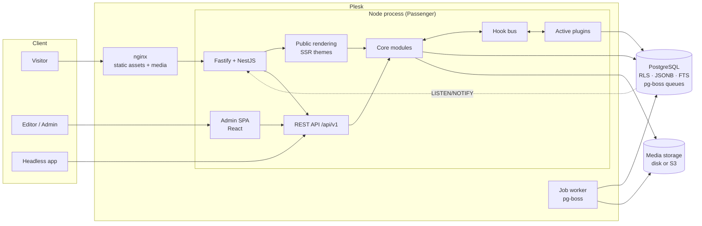
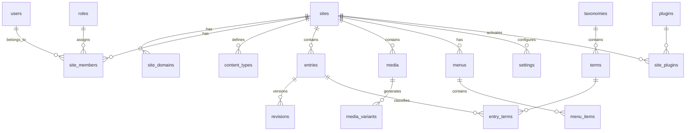
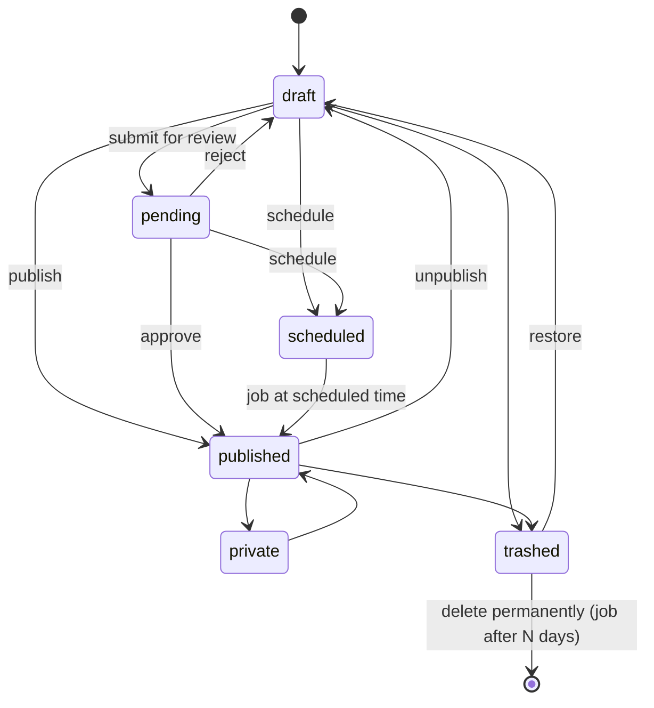
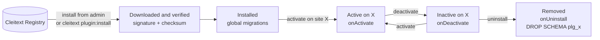
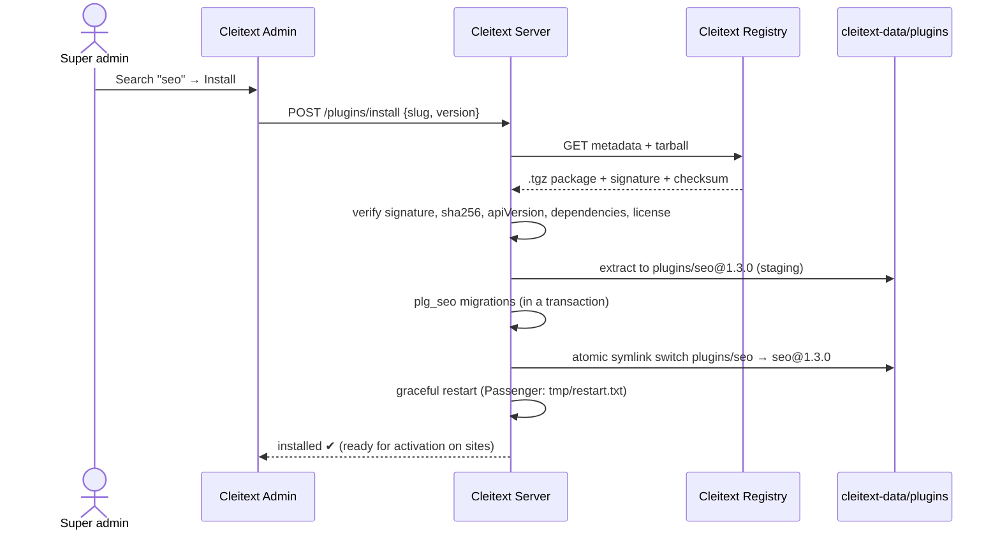

# Cleitext — Architecture

> Version 0.2 · October 2026 · status: **draft for team review**
> Project name: **cleitext** · License: **GPL-2.0-or-later** (like WordPress)
> **Current phase: internal use.** Initially Cleitext powers our own sites and is not distributed. The public registry and domain are deferred to the open-source release phase (see §11.9 and [SPECIFICATIONS.md](./SPECIFICATIONS.md) M8).
> The name combines _Cleito_ (the CMS it grew out of) and _text_: content, blocks and plugins.
> 🇮🇹 Italian version: [docs/it/ARCHITETTURA.md](./it/ARCHITETTURA.md) (secondary, may lag behind).

---

## Table of contents

1. [Vision and principles](#1-vision-and-principles)
2. [Quality goals and constraints](#2-quality-goals-and-constraints)
3. [Technology stack](#3-technology-stack)
4. [Overview](#4-overview)
5. [Monorepo structure](#5-monorepo-structure)
6. [Core modules](#6-core-modules)
7. [PostgreSQL data model](#7-postgresql-data-model)
8. [Multi-site and isolation (RLS)](#8-multi-site-and-isolation-rls)
9. [Content model](#9-content-model)
10. [Editor and blocks](#10-editor-and-blocks)
11. [Plugin system](#11-plugin-system)
12. [Themes and public rendering](#12-themes-and-public-rendering)
13. [API](#13-api)
14. [Security](#14-security)
15. [Performance and caching](#15-performance-and-caching)
16. [Background jobs](#16-background-jobs)
17. [WordPress as a model, not as code](#17-wordpress-as-a-model-not-as-code)
18. [Deployment: Plesk](#18-deployment-plesk)
19. [Observability, testing and quality](#19-observability-testing-and-quality)
20. [Decision log (ADR)](#20-decision-log-adr)
21. [Risks and mitigations](#21-risks-and-mitigations)
22. [Decisions made and open questions](#22-decisions-made-and-open-questions)

---

## 1. Vision and principles

**Cleitext is an open-source CMS that works like WordPress but is not built on WordPress.**

WordPress is the **conceptual and user-experience model**: interface, Gutenberg block editor, content types, taxonomies, themes, plugins, hooks. The code, on the other hand, is entirely our own: TypeScript, PostgreSQL, modern architecture.

Initially the editor **is Gutenberg**, used as a standalone library. The system is, however, designed so that **the editor can be replaced** with another one in the future without touching content, the database, public rendering or server-side plugins (see §10).

### Guiding principles

| #   | Principle                                   | What it means in practice                                                                                                                                                                                          |
| --- | ------------------------------------------- | ------------------------------------------------------------------------------------------------------------------------------------------------------------------------------------------------------------------ |
| P1  | **WordPress as a model, not as code**       | Same concepts and user experience, our own implementation. The core uses its own naming (_entry_, not _post_).                                                                                                     |
| P2  | **Replaceable editor**                      | Gutenberg is an _adapter_ behind the `EditorAdapter` interface. Content is stored in the Cleitext format (**CXD**), not in Gutenberg markup. Switching editors means writing a new adapter, not migrating content. |
| P3  | **Small core, everything else is a plugin** | The core handles sites, users, content, media, menus, themes and plugins. Forms and advanced SEO are plugins; comments, sign-ups and author pages are in the core, as in WordPress (ADR 018).                      |
| P4  | **The plugin API is the product**           | A semver-versioned contract, documented and tested. Breaking it has an explicit cost.                                                                                                                              |
| P5  | **Secure by default**                       | Isolation between sites in the database, granular permissions, non-executable uploads, no secrets in the code.                                                                                                     |
| P6  | **Make the most of PostgreSQL**             | JSONB, full-text search, RLS, LISTEN/NOTIFY, job queues: no mandatory Redis or Elasticsearch.                                                                                                                      |
| P7  | **Modular monolith**                        | A single deployable process, modules with clear boundaries. It can be split up if and when needed.                                                                                                                 |
| P8  | **End-to-end types**                        | Zod schemas shared across database, API, admin and plugins.                                                                                                                                                        |

### What Cleitext is _not_

- It is not a fork of WordPress and contains no WordPress PHP code. It only uses the JavaScript packages of the Gutenberg editor (`@wordpress/block-editor` & co.), isolated in the adapter.
- It is not "pure headless": it has server-side public rendering with themes, plus a complete API for those who use it headless.
- It does not aim to run existing WordPress plugins or themes.

---

## 2. Quality goals and constraints

| Attribute               | Measurable goal                                                                                                            |
| ----------------------- | -------------------------------------------------------------------------------------------------------------------------- |
| **Efficiency**          | Cached public page: TTFB p95 < 50 ms. Uncached: < 300 ms. Admin API p95 < 150 ms with 50,000 entries per site.             |
| **Security**            | Zero data leakage between sites (automated isolation tests). OWASP ASVS level 2 as the reference.                          |
| **Stability**           | Semver on the core and the plugin API, deprecations lasting at least 2 minor versions, forward-only and tested migrations. |
| **Modularity**          | Every non-essential feature is a plugin that can be deactivated without breaking the core.                                 |
| **Footprint**           | Less than 300 MB of RAM per process. One instance handles at least 100 sites.                                              |
| **Admin accessibility** | WCAG 2.1 AA.                                                                                                               |

**Constraints:**

- Database: **PostgreSQL** (16 minimum, 17+ recommended).
- Reference hosting: **Plesk with the Node.js extension** (Phusion Passenger). Docker is **not** part of the project for now.
- Runtime: **Node.js 24 LTS** (minimum 22 LTS).
- License: **GPL-2.0-or-later**, the same as WordPress and the Gutenberg packages. The plugin model is the WordPress one (§11.10). Dependencies must have GPL-compatible licenses, and a license checker verifies this in CI.

---

## 3. Technology stack

| Layer            | Choice                                                                                                                                                   | Rationale                                                                                                             | Rejected alternatives                                                                                                       |
| ---------------- | -------------------------------------------------------------------------------------------------------------------------------------------------------- | --------------------------------------------------------------------------------------------------------------------- | --------------------------------------------------------------------------------------------------------------------------- |
| Language         | **TypeScript** (strict)                                                                                                                                  | A single language for server, admin, editor and plugins.                                                              | PHP (a valid choice, but two languages), Go/Rust (dynamic plugins are hard)                                                 |
| Server framework | **NestJS with the Fastify adapter**                                                                                                                      | Modules, dependency injection, guards and interceptors for modularity; Fastify for performance.                       | Plain Fastify (architecture to be built by hand), Express (slower)                                                          |
| ORM / queries    | **Drizzle ORM** + `postgres` (driver)                                                                                                                    | Strong types, transparent SQL, excellent JSONB support.                                                               | Prisma (separate engine, less SQL control), TypeORM                                                                         |
| Validation       | **Zod**                                                                                                                                                  | Schemas shared across API, admin and plugins, with OpenAPI generation.                                                | class-validator (server-side only)                                                                                          |
| Editor           | **Standalone Gutenberg** (`@wordpress/block-editor`, `@wordpress/components`, selected blocks from `@wordpress/block-library`) behind an `EditorAdapter` | Identical WordPress experience from day one, mature ecosystem, accessible. The stored format (CXD) stays independent. | Lexical/Tiptap with a custom block layer (months of work to reach the same UX): they remain candidates for a future adapter |
| Admin UI         | **React + Vite + Tailwind + shadcn/ui (Radix)**                                                                                                          | Accessible components that we own, no lock-in.                                                                        | MUI/Ant (imposed look)                                                                                                      |
| Admin data       | **TanStack Query + TanStack Router**                                                                                                                     | Client cache and typed routing.                                                                                       | Redux, React Router                                                                                                         |
| Public rendering | **React SSR** (server only, no hydration by default)                                                                                                     | Typed TSX themes, same skills as the admin, optional interactive "islands".                                           | Eta/Nunjucks/Liquid (rejected: decision made, themes in React)                                                              |
| Jobs             | **pg-boss** (queues on PostgreSQL)                                                                                                                       | No Redis, transactional with the data.                                                                                | BullMQ (requires Redis)                                                                                                     |
| Images           | **sharp**                                                                                                                                                | Fast AVIF/WebP variants.                                                                                              | ImageMagick                                                                                                                 |
| Passwords        | **argon2id** (`@node-rs/argon2`)                                                                                                                         | Current standard.                                                                                                     | bcrypt                                                                                                                      |
| Logging          | **pino**                                                                                                                                                 | Fast structured logs, native in Fastify.                                                                              | winston                                                                                                                     |
| Monorepo         | **pnpm + Turborepo**                                                                                                                                     | Workspaces and incremental builds.                                                                                    | Nx (heavier)                                                                                                                |
| Testing          | **Vitest, Playwright, embedded PostgreSQL**                                                                                                              | Unit, end-to-end and real PostgreSQL without containers.                                                              | Jest, Testcontainers (requires Docker)                                                                                      |

---

## 4. Overview



**Flow of a public request:**

1. nginx serves assets and media directly, without going through Node.
2. Fastify resolves the **site from the host** (`site_domains`) and opens a transaction with `SET LOCAL app.site_id`.
3. It checks the page cache: on a _hit_, it responds immediately.
4. The content router resolves permalink → entry (honoring `redirects`).
5. The theme's template hierarchy picks the template, the block tree is turned into HTML and plugin filters are applied.
6. The response is stored in the cache with tags (`entry:<id>`, `menu:<id>`, `type:<slug>`).

---

## 5. Monorepo structure

```
cleitext/
├─ apps/
│  ├─ server/              # NestJS+Fastify bootstrap, module composition, config
│  ├─ admin/               # React SPA (Vite) — served from /cl-admin
│  └─ worker/              # job worker entrypoint (same code, different role)
├─ packages/
│  ├─ core/                # core modules (sites, users, content, media, menus, settings…)
│  ├─ db/                  # Drizzle schema, core migrations, RLS helpers
│  ├─ shared/              # Zod schemas, types, errors, shared constants
│  ├─ hooks/               # typed hook bus (actions/filters)
│  ├─ plugin-sdk/          # public API for plugin authors (server)
│  ├─ admin-sdk/           # public API for extending the admin (React)
│  ├─ blocks/              # CXD format, block registry, core blocks
│  ├─ editor-core/         # EditorAdapter interface, editor-agnostic edit screen (document, saving, panels)
│  ├─ editor-gutenberg/    # Gutenberg adapter: CXD ⇄ Gutenberg blocks, block registration, media, links
│  ├─ registry-client/     # Cleitext registry client (search, download, signature verification)
│  ├─ theme-sdk/           # theme API (template hierarchy, helpers)
│  ├─ renderer/            # public SSR, page cache
│  └─ cli/                 # `cleitext` command
├─ plugins/                # official plugins (same contract as third-party plugins)
│  ├─ seo/
│  ├─ forms/
│  ├─ redirects-ui/
│  ├─ wp-import/           # WXR importer
│  ├─ wp-compat/           # WP-compatible REST API (subset), WP permalinks
│  └─ cleito-import/       # migration from the old Cleito CMS
├─ themes/
│  └─ aurora/              # default theme
├─ tools/
│  └─ dev-db/              # local PostgreSQL for development (embedded binaries)
└─ docs/
```

**Dependency rules**, enforced in CI with `eslint-plugin-boundaries`:

- `packages/core` **never** imports from `plugins/*` or `themes/*`.
- Plugins import **only** from `plugin-sdk`, `admin-sdk`, `blocks`, `shared`, never from inside `core`.
- **Imports from `@wordpress/*` are allowed only in `packages/editor-gutenberg` and in the blocks' `*.gutenberg.tsx` files.** Server, renderer, core, themes and server-side plugins never import them. This rule is what makes the editor replaceable.

---

## 6. Core modules

Each module is a NestJS module with a **public service** (exposed to plugins through the SDK) and an internal **repository** (Drizzle). Modules do not read other modules' tables: they communicate through services and events.

| Module       | Responsibility                                                         |
| ------------ | ---------------------------------------------------------------------- |
| `sites`      | Sites, domains, active languages, host resolution, tenant context.     |
| `identity`   | Users, sessions, 2FA, passkeys, API tokens, password reset.            |
| `access`     | Roles, capabilities, guards, per-entry policies (owner/others).        |
| `content`    | Content types, entries, revisions, statuses, scheduling, translations. |
| `taxonomy`   | Taxonomies and terms (categories, tags, custom).                       |
| `media`      | Uploads, validation, abstract storage (disk or S3), image variants.    |
| `navigation` | Menus, menu items, theme menu locations.                               |
| `settings`   | Typed settings by namespace (core and plugins).                        |
| `routing`    | Permalinks, redirects, URL → resource resolution.                      |
| `search`     | Per-language full-text indexing.                                       |
| `themes`     | Theme registry, active theme per site, theme settings.                 |
| `plugins`    | Discovery, lifecycle, migrations and per-site activation.              |
| `audit`      | Action log (who, what, when, from where).                              |
| `jobs`       | Facade over pg-boss, scheduled jobs (cron).                            |
| `cache`      | Tagged page cache and cross-process invalidation.                      |

---

## 7. PostgreSQL data model

### 7.1 Conventions

- **UUID v7** primary keys (time-ordered), generated by the application.
- `timestamptz` everywhere, times in UTC.
- Every tenant table has `site_id uuid not null` with RLS enabled (see §8).
- `public` schema for the core, **one PostgreSQL schema per plugin** (`plg_<slug>`), `pgboss` schema for the queues.
- Extensions: `citext`, `unaccent`, `pg_trgm`.
- No key/value "meta"-style tables: custom fields go into `JSONB`, validated by Zod and indexed where needed.

### 7.2 Diagram



### 7.3 Reference DDL (core)

```sql
create extension if not exists citext;
create extension if not exists unaccent;
create extension if not exists pg_trgm;

-- ===== Sites =====
create table sites (
  id              uuid primary key,
  slug            text not null unique,
  name            text not null,
  status          text not null default 'active' check (status in ('active','maintenance','archived')),
  default_locale  text not null default 'it',
  timezone        text not null default 'Europe/Rome',
  theme_slug      text,
  created_at      timestamptz not null default now()
);

create table site_domains (
  id          uuid primary key,
  site_id     uuid not null references sites(id) on delete cascade,
  host        citext not null unique,          -- tenant resolution by host
  is_primary  boolean not null default false,
  force_https boolean not null default true
);

-- ===== Identity and access =====
create table users (
  id             uuid primary key,
  email          citext not null unique,
  display_name   text not null,
  password_hash  text,                         -- argon2id; null if passkey/SSO only
  status         text not null default 'active' check (status in ('active','invited','suspended')),
  totp_secret    text,                         -- encrypted at the application level
  locale         text not null default 'it',
  created_at     timestamptz not null default now(),
  last_login_at  timestamptz
);

create table roles (
  id            uuid primary key,
  site_id       uuid references sites(id) on delete cascade,  -- null = system role
  slug          text not null,
  name          text not null,
  capabilities  text[] not null default '{}',
  unique (site_id, slug)
);

create table site_members (
  site_id  uuid not null references sites(id) on delete cascade,
  user_id  uuid not null references users(id) on delete cascade,
  role_id  uuid not null references roles(id),
  primary key (site_id, user_id)
);

create table sessions (
  id          text primary key,                -- hash of the session token
  user_id     uuid not null references users(id) on delete cascade,
  expires_at  timestamptz not null,
  ip          inet,
  user_agent  text,
  created_at  timestamptz not null default now()
);

create table api_tokens (
  id           uuid primary key,
  site_id      uuid not null references sites(id) on delete cascade,
  user_id      uuid references users(id) on delete cascade,
  name         text not null,
  token_hash   text not null unique,
  scopes       text[] not null,
  expires_at   timestamptz,
  last_used_at timestamptz
);

-- ===== Content =====
create table content_types (
  id            uuid primary key,
  site_id       uuid not null references sites(id) on delete cascade,
  slug          text not null,                 -- 'page', 'article', 'event'…
  name          jsonb not null,                -- labels per language
  source        text not null default 'core',  -- 'core' | 'user' | 'plugin:<slug>'
  hierarchical  boolean not null default false,
  supports      text[] not null default '{title,blocks,revisions}',
  fields_schema jsonb not null default '{}',   -- field definitions (see SPECIFICATIONS)
  permalink     text not null default '/{slug}',
  unique (site_id, slug)
);

create table entries (
  id                     uuid primary key,
  site_id                uuid not null references sites(id) on delete cascade,
  type_slug              text not null,
  locale                 text not null,
  parent_id              uuid references entries(id) on delete set null,
  slug                   text not null,
  title                  text not null default '',
  status                 text not null default 'draft'
                         check (status in ('draft','pending','scheduled','published','private','trashed')),
  author_id              uuid references users(id) on delete set null,
  current_revision_id    uuid,                 -- latest saved revision
  published_revision_id  uuid,                 -- revision visible to the public
  published_at           timestamptz,
  scheduled_at           timestamptz,
  position               int not null default 0,
  search                 tsvector,             -- updated on publish
  created_at             timestamptz not null default now(),
  updated_at             timestamptz not null default now(),
  trashed_at             timestamptz,
  unique (site_id, type_slug, locale, slug)
);
create index entries_list_idx on entries (site_id, type_slug, status, published_at desc);
create index entries_search_idx on entries using gin (search);

create table revisions (
  id              uuid primary key,
  site_id         uuid not null references sites(id) on delete cascade,
  entry_id        uuid not null references entries(id) on delete cascade,
  kind            text not null default 'manual' check (kind in ('manual','autosave','import','restore')),
  title           text not null,
  fields          jsonb not null default '{}',  -- validated custom fields
  document        jsonb not null,               -- Cleitext Document (CXD)
  schema_version  int  not null,                -- CXD format version
  author_id       uuid references users(id) on delete set null,
  created_at      timestamptz not null default now()
);
create index revisions_entry_idx on revisions (entry_id, created_at desc);

-- ===== Taxonomies =====
create table taxonomies (
  id             uuid primary key,
  site_id        uuid not null references sites(id) on delete cascade,
  slug           text not null,
  name           jsonb not null,
  hierarchical   boolean not null default false,
  content_types  text[] not null default '{}',
  unique (site_id, slug)
);

create table terms (
  id                 uuid primary key,
  site_id            uuid not null references sites(id) on delete cascade,
  taxonomy_id        uuid not null references taxonomies(id) on delete cascade,
  locale             text not null,
  parent_id          uuid references terms(id) on delete set null,
  slug               text not null,
  name               text not null,
  description        text,
  fields             jsonb not null default '{}',
  unique (taxonomy_id, locale, slug)
);

create table entry_terms (
  entry_id  uuid not null references entries(id) on delete cascade,
  term_id   uuid not null references terms(id) on delete cascade,
  site_id   uuid not null,
  position  int not null default 0,
  primary key (entry_id, term_id)
);

-- ===== Media =====
create table media (
  id           uuid primary key,
  site_id      uuid not null references sites(id) on delete cascade,
  storage_key  text not null,                  -- path in storage (never the original name)
  filename     text not null,                  -- original name, metadata only
  mime         text not null,                  -- verified via magic bytes
  size_bytes   bigint not null,
  width        int,
  height       int,
  checksum     text not null,                  -- sha256, for deduplication
  alt          jsonb not null default '{}',    -- alt text per language
  caption      jsonb not null default '{}',
  focal_point  jsonb,
  uploaded_by  uuid references users(id) on delete set null,
  created_at   timestamptz not null default now()
);

create table media_variants (
  media_id     uuid not null references media(id) on delete cascade,
  site_id      uuid not null,
  variant      text not null,                  -- 'thumb', 'md', 'lg', 'xl'
  format       text not null,                  -- 'avif', 'webp', 'jpeg'
  storage_key  text not null,
  width        int not null,
  height       int not null,
  size_bytes   bigint not null,
  primary key (media_id, variant, format)
);

-- ===== Navigation =====
create table menus (
  id        uuid primary key,
  site_id   uuid not null references sites(id) on delete cascade,
  slug      text not null,
  name      text not null,
  locale    text not null,
  location  text,                              -- theme location: 'primary', 'footer'…
  unique (site_id, slug, locale)
);

create table menu_items (
  id         uuid primary key,
  site_id    uuid not null,
  menu_id    uuid not null references menus(id) on delete cascade,
  parent_id  uuid references menu_items(id) on delete cascade,
  position   int not null default 0,
  kind       text not null check (kind in ('entry','term','url','custom')),
  entry_id   uuid references entries(id) on delete cascade,
  term_id    uuid references terms(id) on delete cascade,
  url        text,
  label      text,                              -- if null, the entry or term title is used
  target     text,
  attrs      jsonb not null default '{}'
);

-- ===== Settings, routing, plugins, audit =====
create table settings (
  site_id    uuid not null references sites(id) on delete cascade,
  namespace  text not null,                    -- 'core', 'theme', 'plugin:seo'
  key        text not null,
  value      jsonb not null,
  primary key (site_id, namespace, key)
);

create table redirects (
  id         uuid primary key,
  site_id    uuid not null references sites(id) on delete cascade,
  from_path  text not null,
  to_path    text not null,
  status     int  not null default 301 check (status in (301,302,307,308,410)),
  hits       bigint not null default 0,
  unique (site_id, from_path)
);

create table plugins (                         -- global installation (code present)
  slug          text primary key,
  version       text not null,
  api_version   text not null,
  installed_at  timestamptz not null default now(),
  manifest      jsonb not null
);

create table site_plugins (                    -- per-site activation
  site_id      uuid not null references sites(id) on delete cascade,
  plugin_slug  text not null references plugins(slug) on delete cascade,
  active       boolean not null default false,
  activated_at timestamptz,
  primary key (site_id, plugin_slug)
);

create table plugin_migrations (
  plugin_slug  text not null,
  migration    text not null,
  checksum     text not null,
  applied_at   timestamptz not null default now(),
  primary key (plugin_slug, migration)
);

create table audit_log (
  id           bigint generated always as identity primary key,
  site_id      uuid,
  user_id      uuid,
  action       text not null,                  -- 'entry.publish', 'user.login.failed'…
  target_type  text,
  target_id    text,
  meta         jsonb not null default '{}',
  ip           inet,
  created_at   timestamptz not null default now()
);
create index audit_site_time_idx on audit_log (site_id, created_at desc);
```

> The DDL above is the **conceptual reference**. The source of truth will be the Drizzle schema in `packages/db`, from which migrations are generated.

---

## 8. Multi-site and isolation (RLS)

The old Cleito used `site_id` in every table, and the idea is still sound. The difference is that **isolation is enforced by the database**, not left to the discipline of whoever writes the code.

```sql
-- Application role: NOT the table owner, NOT a superuser
create role cleitext_app login;

alter table entries enable row level security;
alter table entries force row level security;

create policy tenant_isolation on entries
  using      (site_id = current_setting('app.site_id', true)::uuid)
  with check (site_id = current_setting('app.site_id', true)::uuid);
-- (same policy generated for every table with site_id, via migration)
```

**Per-request cycle:**

1. Fastify `onRequest` resolves `Host` → `site_domains` → `site_id`, with an in-memory cache invalidated via NOTIFY.
2. It opens a transaction and runs `SET LOCAL app.site_id = '<uuid>'`. `SET LOCAL` is safe even with connection pooling, because it only applies to the transaction.
3. All queries in the request go through that transaction (`AsyncLocalStorage` carries the context).
4. Cross-site operations (super admin, CLI, migrations) use a separate `cleitext_admin` role with `BYPASSRLS`, and only in explicit code paths that are recorded in the audit log.

**Mandatory tests:** a dedicated suite creates two sites and verifies that no endpoint and no service returns data from the other site (`packages/db/test/tenant-isolation.test.ts`).

**Implementation notes** (`packages/db/drizzle/0001_tenant_rls.sql`):

- The current site is read through `cleitext_current_site_id()`, which maps an empty setting to `NULL`. After a transaction that used `SET LOCAL`, the setting reverts to `''`, not `NULL`, and must not break queries on the same pooled connection.
- Tenant tables are `FORCE`d. `sites`, `site_domains`, `users` and `roles` have RLS enabled but are not forced, because the owner (CLI, installer) manages them. The application role never owns tables, so it is always subject to the policies.
- Host resolution happens before any site context exists, through the `SECURITY DEFINER` function `cleitext_resolve_site(host)`, which returns only the site id.
- Foreign-key checks bypass RLS. Child rows therefore reference parents through **composite foreign keys `(site_id, id)`**, so a row of site A can never point to a row of site B.
- **One connection per request.** A transaction holds its connection until it ends, so code running inside it must never wait for a second connection of the same pool: under load every request would hold one and wait for another, and the app would hang. `withContext` called inside an open transaction of the same site runs in a savepoint of it, on its connection, and the transaction commits only after those savepoints end. `notify` inside a transaction goes with it (delivered on commit). Any other query or transaction that takes a second connection is reported (`CLEITEXT_DB_NESTING=error` makes it fail, as in the server tests); `apps/server/test/pool.test.ts` runs the app with one connection per pool.
- `users` are global: the application only sees members of the current site. `roles` with `site_id IS NULL` are system roles, readable by every site and writable only by the owner.
- Privileges for the application role are granted by `cleitext_grant_app(role)`, executed after every migration.

**Identity** (`packages/db/drizzle/0003_identity_functions.sql`, milestone M1):

- Requests also set `app.user_id`. A user can always read their own record, even on a site where they are not a member (super admins).
- Global tables, looked up before any site context exists: `sessions` and `user_tokens` (password reset and invitation links), both storing only SHA-256 hashes of the tokens, and `login_throttle` (failed-login counters). `super_admins` is global and **read-only** for the application role, so the application can never grant the flag.
- `SECURITY DEFINER` functions return only what is needed: `cleitext_find_login(email)` for sign-in, `cleitext_resolve_host(host)` for the site and domain policy, and `cleitext_my_sites()` for the site switcher.
- A trigger ensures that a membership uses a system role or a role of the same site. A foreign key cannot express this, because system roles have a `NULL` `site_id`.
- The default roles (Administrator, Editor, Author, Contributor, Subscriber) are seeded as system roles and mirror `DEFAULT_ROLES` in `@cleitext/shared`. A test checks that the two match.
- Inserting a row that the application cannot read back under RLS (for example a user who is not yet a member) uses ids generated by the application (`newId()`), not `RETURNING`.

---

## 9. Content model

### 9.1 Concepts

- **Content type** (`content_types`): defines the custom fields (`fields_schema`), the supported features (blocks, excerpt, featured image, hierarchy, revisions) and the permalink. The `page` and `article` types are created by the core. Others are created from the admin or registered by plugins.
- **Entry**: an instance of a piece of content, in **one language**.
- **Revision**: an immutable snapshot of the title, fields and block document.
- **Translation group**: links entries that represent the same content in different languages. It is kept by the language plugin (§9.4), not by the core.

### 9.2 Lifecycle



- **Save** = new `manual` revision + updated `current_revision_id`.
- **Autosave** every 30 seconds = `autosave` revision. Only the latest one per user and entry is kept.
- **Publish** = `published_revision_id := current_revision_id`. The public sees _only_ `published_revision_id`, so published content can be edited without exposing drafts.
- **Revision cleanup**: the latest N (configurable), the published ones and labeled ones are kept.

### 9.3 Custom fields

They are defined with a JSON-serializable DSL checked with Zod (SPECIFICATIONS §10): `text`, `url`, `number`, `boolean`, `date`, `datetime`, `select`, `choice`, `media`, `color`, `code`, `list`, the design types of themes, and types of plugins (`<plugin>/<name>`, plugin API 1.47). The following rules apply:

- server-side validation **always**, even if the admin has already validated; `required` fields when publishing;
- a **field type registry** (`packages/shared/src/field-types.ts`): each type checks its settings and values, formats them for templates (`useField`), gives their index value and exports references as refs; the admin draws plugin types with their components;
- **field groups** with location rules (`packages/shared/src/field-groups.ts`), evaluated by the core on the server and live in the admin: the site owners' (`field_groups` table, `/api/v1/field-groups`), the plugins' (`ctx.fields`) and the theme's (`entryFields`);
- values stay JSON: `revisions.fields` (revisions, drafts and translations for free), `terms.fields`, `user_fields` (per site); every list row has a stable `_id`;
- **dynamic sources** (`ctx.dynamic`) give formatted values to page builders, block bindings and themes;
- the admin generates field forms from the definitions;
- planned: indexes on fields (`indexed`), queries and list columns by field.

### 9.4 Languages

- The core knows the site's **default language** (`sites.default_locale`) and the language of each entry, term and menu (`locale`). Slugs are unique per language.
- Everything else belongs to a **language plugin** (M7), such as the official Multilingual plugin: the other languages with their URL prefixes (`/en/…`), and the translation groups of entries and terms (like WPML's `icl_translations`).
- The plugin tells the core what it needs through a `LanguageProvider` (`locales`, `translations`). With it the core routes prefixed addresses, builds the URLs of each language, writes `hreflang` (pages, archives, sitemaps) and gives themes the language switcher.
- Without a language plugin, `LanguagesService` answers with the default language only, without a query or a plugin call: a monolingual site pays nothing (tested in CI).
- Data the plugin does not hold yet (sites from before M7, imported sites) waits as "pending language data" in `settings` (`languages`/`pending`) until a language plugin takes it over.
- Planned in the plugin: fallback to the default language for untranslated pages, a domain per language.

---

## 10. Editor and blocks

### 10.0 Principle: Gutenberg today, a replaceable editor tomorrow

The initial editor is **Gutenberg**, in its standalone version as a React library: `@wordpress/block-editor`, `@wordpress/components`, `@wordpress/blocks` and a selection of blocks from `@wordpress/block-library`. Users get exactly the WordPress experience: inserter, toolbar, inspector, list view, patterns.

Gutenberg, however, is **an adapter, not the heart of the system**:

```mermaid
flowchart LR
    subgraph Indipendente["Editor-independent"]
        DB[(PostgreSQL<br/>revisions.document = CXD)]
        API[API /entries]
        R[SSR renderer<br/>block render()]
        BD[Block definitions<br/>type · Zod schema · render]
    end
    subgraph Adattatori["Replaceable"]
        EA{{EditorAdapter}}
        G[editor-gutenberg<br/>today]
        X[editor-xyz<br/>tomorrow]
    end
    DB <--> API <--> EA
    EA --- G
    EA -.- X
    BD --> R
    BD --> G
```

**What stays the same if the editor changes:** database, CXD format, API, public rendering, themes, plugin server logic, block definitions (type, attributes, render, migrations).

**What has to be rewritten:** the adapter package and the blocks' _edit_ components (`*.gutenberg.tsx` → `*.<new>.tsx`).

**What we do NOT use from Gutenberg:**

- HTML serialization with `<!-- wp:paragraph -->` comments: we store CXD;
- the blocks' `save()` functions: the public HTML is produced by our renderer;
- `@wordpress/core-data` and calls to the WordPress REST API: data, media and links go through our API via the adapter.

### 10.1 Cleitext Document (CXD)

The **stored format** is neither Gutenberg markup nor the internal state of any editor. It is a Cleitext format, versioned and documented:

```json
{
  "schema": 1,
  "blocks": [
    {
      "id": "b_01JA9X…",
      "type": "core/heading",
      "v": 1,
      "attrs": { "level": 2, "anchor": "intro" },
      "content": [{ "text": "Welcome " }, { "text": "aboard", "marks": ["bold"] }]
    },
    {
      "id": "b_01JA9Y…",
      "type": "core/columns",
      "v": 1,
      "attrs": { "gap": "md" },
      "children": [{ "id": "…", "type": "core/column", "v": 1, "attrs": {}, "children": [/* … */] }]
    }
  ]
}
```

- `content`: inline text as an array of spans with `marks` (bold, italic, code, highlight…) and an optional text `color`, and links (which may have their own `color`), in the style of Portable Text. Colors are hex, `rgb()`/`hsl()` or a palette variable (`var(--name)`).
- `attrs.style` (core blocks): spacing (margin, padding), custom text and background colors and text size, as WordPress saves them; only safe values are shown, as the block's inline style.
- `children`: nested blocks, for container blocks.
- `v`: version of the attribute schema **of the individual block**, used for migrations.

**Why our own format:** if Gutenberg is replaced in the future, content stays valid and only the adapter is rewritten. Rich text, which in Gutenberg is an HTML string inside attributes (for example the `content` of `core/paragraph`), is converted and sanitized into `content` spans by the adapter on save, and converted back on load.

**Block names:** core blocks use the `core/` namespace with the same names as Gutenberg (`core/paragraph`, `core/columns`…). This makes the Gutenberg adapter almost a one-to-one mapping, but the meaning of the names is defined by Cleitext, not by WordPress.

### 10.2 The `EditorAdapter` interface

```ts
interface EditorAdapter {
  id: string; // 'gutenberg'
  mount(el: HTMLElement, opts: EditorMountOptions): EditorInstance;
}

interface EditorMountOptions {
  document: CxdDocument; // initial content
  blocks: BlockDefinition[]; // available blocks (core + plugins)
  patterns: Pattern[];
  services: {
    // implemented by Cleitext, NOT by WordPress
    uploadMedia(file: File): Promise<MediaRef>;
    searchLinks(q: string): Promise<LinkSuggestion[]>;
    getMedia(id: string): Promise<MediaView>;
    oembed(url: string): Promise<EmbedData>;
  };
  locale: string;
  readOnly?: boolean;
  onChange(doc: CxdDocument): void; // used for autosave and "modified" state
}

interface EditorInstance {
  getDocument(): CxdDocument;
  insertBlocks(blocks: CxdBlock[]): void;
  undo(): void;
  redo(): void;
  destroy(): void;
}
```

The edit screen (`editor-core`) is editor-agnostic: top bar, save/publish buttons, the inspector's _Document_ tab with status, taxonomies, fields and plugin panels. Only the block area and the _Block_ tab belong to the adapter.

### 10.3 Block definition

The definition is **split into two parts**: an editor-agnostic one (server and renderer) and an editor-specific one.

```ts
// blocks/hero/index.ts — agnostic: used by the server, renderer and validation
export default defineBlock({
  type: 'acme/hero',
  version: 2,
  title: { it: 'Hero', en: 'Hero' },
  category: 'layout',
  icon: 'cover',
  attrs: z.object({
    mediaId: z.string().uuid().optional(),
    overlay: z.number().min(0).max(1).default(0.4),
    align: z.enum(['left', 'center']).default('center'),
  }),
  allowedChildren: ['core/heading', 'core/paragraph', 'core/buttons'],
  migrate: { 1: (a) => ({ ...a, align: a.centered ? 'center' : 'left' }) },  // v1 → v2
  render: (ctx) => <Hero {...ctx.attrs}>{ctx.children}</Hero>,               // public SSR
  editors: {
    gutenberg: () => import('./hero.gutenberg'),   // loaded only in the admin
  },
});
```

```tsx
// blocks/hero/hero.gutenberg.tsx — the only file that knows about Gutenberg
import { InnerBlocks, InspectorControls, MediaPlaceholder } from '@wordpress/block-editor';
import { PanelBody, RangeControl } from '@wordpress/components';

export default defineGutenbergEdit<'acme/hero'>(({ attributes, setAttributes }) => (
  <>
    <InspectorControls>
      <PanelBody title="Overlay">
        <RangeControl
          value={attributes.overlay}
          min={0}
          max={1}
          step={0.1}
          onChange={(overlay) => setAttributes({ overlay })}
        />
      </PanelBody>
    </InspectorControls>
    {/* … */}
    <InnerBlocks allowedBlocks={['core/heading', 'core/paragraph', 'core/buttons']} />
  </>
));
```

- The adapter registers the block in Gutenberg (`registerBlockType`) using the Zod schema for the attributes, the `edit` component and `save: () => null`. Saving always goes through CXD.
- **A block with no component for the active editor** is shown with a _form automatically generated from the Zod schema_, so it remains editable even after an editor switch, before anyone rewrites its component.
- For core blocks, **the `edit` components from `@wordpress/block-library` are reused** where possible, with a server renderer written by us.

### 10.4 Editor interface (Gutenberg)

- **Inserter** ("+" button and quick search with `/`), blocks grouped by category, patterns.
- **Block toolbar**: move up/down, drag, transform to, duplicate, delete.
- **Inspector** (right sidebar), with two tabs:
  - _Document_: status, scheduling, permalink, taxonomies, featured image, custom fields, plugin panels.
  - _Block_: the block's `InspectorControls` (Gutenberg), or a form generated from the Zod schema.
- **List view** (tree structure), undo/redo, keyboard shortcuts.
- **Patterns**: saved, reusable sets of blocks. There are _synced patterns_ (the equivalent of reusable blocks) and _unsynced patterns_.
- Real **preview** through the theme renderer, with a temporary preview token.

### 10.5 Core blocks (MVP)

`paragraph`, `heading`, `list`, `quote`, `image`, `gallery`, `buttons`/`button`, `columns`/`column`, `group`, `separator`, `spacer`, `embed` (YouTube/Vimeo/oEmbed), `html` (only for users with the `unfiltered_html` capability), `table`, `code`.

Each one needs an editor-agnostic definition (schema and render), a Gutenberg edit component (reused from `block-library` where possible) and CXD ⇄ Gutenberg round-trip tests.

### 10.6 Technical notes on the Gutenberg integration

- **Size**: Gutenberg is heavy, about 1–2 MB gzipped with its dependencies. It must be loaded **only on the edit screen** (lazily), while the rest of the admin stays lightweight.
- **Styles**: editor styles are isolated in an editing iframe (supported by the block editor), so they do not conflict with the admin's Tailwind. The active theme's styles are injected into the iframe for an accurate preview (_editor styles_).
- **Versions**: the `@wordpress/*` packages must be updated **all together** and with a pinned version. Every update goes through the round-trip tests and the editor E2E tests.
- **Reference**: projects such as _Isolated Block Editor_ (Automattic) show how to use Gutenberg outside WordPress and are useful as an implementation reference.

**As implemented in M2** (`packages/editor-gutenberg`):

- Blocks are registered one by one from `@wordpress/block-library` (`build-module/<block>`); WordPress-specific blocks (post title, query loop…) are never loaded.
- The canvas is `BlockCanvas` (iframe). Content and editing-UI styles (`components`, `block-editor/content.css`, `block-library` style, theme and editor CSS) are passed as `__unstableResolvedAssets`; the admin keeps only the UI styles.
- Gutenberg internals that call the WordPress REST API (`core-data`) are answered locally by an `apiFetch` fetch handler: no request leaves the browser.
- The image block's "Media Library" is replaced through the `editor.MediaUpload` filter with a picker backed by Cleitext's media API (`EditorServices`).
- Measured sizes: about 950 kB gzip for the editor chunk, loaded only on the edit screen; the initial admin bundle is about 140 kB gzip.

---

## 11. Plugin system

### 11.1 What a plugin is

A plugin is an **npm package** (or a folder in `plugins/`) containing a manifest and one or more entry points:

```
plugins/seo/
├─ package.json
├─ cleitext.plugin.json        # manifest
├─ src/server/index.ts        # server entry (definePlugin)
├─ src/admin/index.tsx        # admin entry (optional, ESM)
├─ src/blocks/…               # blocks (optional)
└─ migrations/                # SQL in the plg_seo schema
```

### 11.2 Manifest

```json
{
  "slug": "seo",
  "name": "Cleitext SEO",
  "version": "1.3.0",
  "apiVersion": "^1.0",
  "description": "Meta tags, Open Graph, sitemap, schema.org",
  "author": "Cleitext Team",
  "license": "GPL-2.0-or-later",
  "server": "dist/server/index.js",
  "admin": "dist/admin/index.js",
  "requires": { "plugins": { "forms": "^2.0" } },
  "capabilities": ["manage_seo"],
  "permissions": ["content:read", "settings:own", "http:outbound"],
  "settingsSchema": "dist/settings.schema.json"
}
```

### 11.3 Lifecycle



- **Install** (global): from the registry, from the upload of a `.zip` or `.tgz` package (like WordPress's _Upload Plugin_) or from the developer's update server. This is followed by verification of checksum, `apiVersion` and dependencies (plus the signature, if the package comes from the registry) and by the migrations in the `plg_<slug>` schema. It can be done **from the admin** (super admin) or from the CLI (§11.9).
- **Activate / Deactivate** (per site): `onActivate` / `onDeactivate` hooks. Data is kept.
- **Uninstall**: `onUninstall`, then `DROP SCHEMA plg_<slug> CASCADE` and removal of the namespace's `settings`, with explicit confirmation.
- **Loading**: at startup the server reads the installed plugins, imports them (`import()`) and registers their dynamic NestJS modules. **Installing or updating a plugin requires a graceful restart** of the process, which on Passenger is achieved with `tmp/restart.txt`. Activating or deactivating on a site does **not** require a restart, because hooks are filtered per site at runtime.

### 11.4 Server entry point

```ts
import { definePlugin } from '@cleitext/plugin-sdk';

export default definePlugin({
  setup(ctx) {
    // Hooks: action (event) and filter (transformation), with priority
    ctx.hooks.on('entry.published', async ({ entry }) => {
      await ctx.jobs.enqueue('seo.ping-sitemaps', { siteId: entry.siteId });
    });

    ctx.hooks.filter('render.head', (head, { entry }) => head.concat(buildMetaTags(entry)), {
      priority: 20,
    });

    // Declarative extensions
    ctx.content.registerFieldGroup({ types: ['page', 'article'], fields: seoFields });
    ctx.routes.get('/sitemap.xml', sitemapHandler, { public: true, cache: '1h' });
    ctx.jobs.define('seo.ping-sitemaps', pingHandler);
    ctx.settings.define(seoSettingsSchema);
    ctx.access.defineCapability('manage_seo', { defaultRoles: ['admin', 'editor'] });
  },
  async onActivate(site) {
    /* … */
  },
  async onDeactivate(site) {
    /* … */
  },
  async onUninstall() {
    /* … */
  },
});
```

### 11.5 Typed hooks

Hooks are declared with **declaration merging**, so TypeScript knows their payloads:

```ts
// in the core
declare module '@cleitext/hooks' {
  interface Actions {
    'entry.published': { entry: EntryView; site: SiteView };
    'user.login': { user: UserView; ip: string };
  }
  interface Filters {
    'render.head': [head: HeadTag[], ctx: { entry?: EntryView }];
    'entry.permalink': [url: string, ctx: { entry: EntryView }];
    'admin.menu': [items: AdminMenuItem[], ctx: { user: UserView }];
  }
}
// a plugin can in turn declare its own hooks with the same mechanism
```

**Bus rules:**

- _Actions_ are asynchronous and can run synchronously within the transaction (`'tx'`) or after commit (`'afterCommit'`, the default).
- _Filters_ are synchronous or asynchronous functions chained together, executed in priority order.
- A handler error **is logged and isolated**: it does not bring down the request, except for hooks marked `critical`. A plugin that keeps failing is automatically deactivated and the problem is reported on the Dashboard.
- Each handler has a configurable timeout. The time spent by each plugin is measured and visible in the admin.

### 11.6 Data access and permissions

- Plugins do **not** receive the core's database pool. They receive:
  - core **facade services** (`ctx.content`, `ctx.media`, …), limited to the `permissions` declared in the manifest;
  - a Drizzle instance **restricted to their own schema** `plg_<slug>`, with a dedicated PostgreSQL role that has `USAGE` only on that schema and RLS always enabled.
- **Honest limitation:** in Node a plugin is trusted code. There is no real sandbox (it could import `fs`). Permissions serve to reduce mistakes and make installation transparent; they are not a barrier against malicious code. Installation therefore shows the requested permissions and, in the future, the verified origin (package signature).

### 11.7 Admin extensions

The `admin` entry is an ESM module loaded at runtime. `react`, `react-dom` and `@cleitext/admin-sdk` are shared through an **import map**, so the plugin does not include them in its own bundle. The extension points are:

- admin menu items and pages (routes);
- Dashboard widgets;
- panels in the document inspector (per content type);
- editor blocks;
- tabs in the settings (forms generated from `settingsSchema` or custom components);
- bulk actions and columns in list tables.

### 11.8 Plugin API versioning

- `@cleitext/plugin-sdk` follows semver. Every plugin declares `apiVersion`.
- A deprecation lasts at least **two minor versions**, with a warning in the console and in the admin.
- A **contract suite** (tests run against the official plugins) runs in CI on every core change.

### 11.9 Cleitext registry and installing from the admin

> **Phases.**
>
> - **Internal use (now):** plugins are installed from a local folder, from a `.zip`/`.tgz` upload in the admin, or from the CLI. There is no online registry.
> - **Public release (future):** the registry described below is enabled. The core code is already prepared for it: the registry client is a separate module (`registry-client`) and `REGISTRY_URL` is empty by default, so the _Add New_ section only shows the upload.

In the public phase, plugins and themes are distributed through **our own registry** (domain to be decided). From the admin, the super admin searches, installs and updates them, as in WordPress's _Plugins → Add New_.



**Registry (separate service, also open source):**

- **API**: search, metadata, versions, downloads, anonymous installation statistics. A public page for each plugin with description, screenshots, changelog, compatibility and requested permissions.
- **Publishing**: developer accounts, upload via the CLI (`cleitext publish`), **automated review** (valid manifest, build, dependency scan, compatible license, no obfuscated code) plus a **manual review** on first publication.
- **Publishing open to everyone**, like the WordPress.org directory: anyone can publish free plugins and themes with a GPL-compatible license, after review.
- **Signing**: every registry release is signed (Ed25519) and the public key ships with the core. The package is verified before installation.
- **Packages from outside the registry** (manual upload, premium plugins): they are installed **as in WordPress**, with a clear warning that the package has not been verified by the registry. The super admin can forbid them with `PLUGINS_ALLOW_UNSIGNED=false`.
- **Revocation**: the registry can flag a version as compromised. Installations show this in the admin and can deactivate it automatically (configurable).
- **Updates**: periodic check (job) with an admin notification, one-click updates and rollback to the previous version, which is kept.

**Security of installing from the admin:**

- it requires the `manage_plugins` capability: super admins have it, and so do the administrators of an installation with one site (as in WordPress; with several sites only super admins);
- it can be disabled with `PLUGINS_INSTALL_FROM_UI=false`, for example in environments managed via CI;
- plugins live in `cleitext-data/plugins`, outside the release, so they survive deployments. It is the only code folder writable by the process;
- every operation is recorded in the audit log.

**Themes**: same registry, same flow (`cleitext.theme.json`, signature, installation from the admin under _Appearance → Themes_).

### 11.10 Plugin and theme licensing

The core is **GPL-2.0-or-later**, like WordPress, and adopts **the same plugin licensing model**:

- plugins and themes run in the same process and use the SDK, so, as WordPress maintains, their code is considered a derivative work and must be distributed under a **GPL-compatible** license (GPL-2.0-or-later, GPL-3.0, or MIT, Apache-2.0 or BSD for the code);
- the **registry** only accepts free plugins and themes with a GPL-compatible license, like WordPress.org;
- **premium plugins** are allowed as in WordPress: they are sold on the developer's site (the code remains under the GPL, while support, updates and services are paid), installed via upload and updated from the developer's server (`updateSource` field in the manifest). Assets such as images, CSS or front-end JavaScript may have different licenses, as in WordPress;
- official plugins are GPL-2.0-or-later.

> Whether plugins really are "derivative works" is a debated legal question. Cleitext adopts the same position as WordPress for consistency with that model. Before 1.0, a legal review of the license text and the registry terms is required.

### 11.11 Mapping to the WordPress plugin system

| WordPress                                                                   | Cleitext                                                                                    |
| --------------------------------------------------------------------------- | ------------------------------------------------------------------------------------------- |
| Main plugin file header (`Plugin Name`, `Version`, `Requires at least`…)    | `cleitext.plugin.json` manifest (`name`, `version`, `requires.cleitext`…)                   |
| `register_activation_hook` / `register_deactivation_hook` / `uninstall.php` | `onActivate` / `onDeactivate` / `onUninstall`                                               |
| `add_action` / `add_filter` / `do_action` / `apply_filters`, with priority  | `hooks.on` / `hooks.filter` / `hooks.emit`, with priority and types                         |
| _Plugins → Add New_ (WordPress.org directory)                               | _Plugins → Add New_ (Cleitext registry)                                                     |
| _Upload Plugin_ (.zip)                                                      | `.zip` / `.tgz` upload                                                                      |
| Per-plugin automatic updates (individually toggleable)                      | Per-plugin toggle: automatic updates on/off                                                 |
| `Update URI` for premium plugins                                            | `updateSource` in the manifest                                                              |
| Per-site activation and _Network Activate_ (multisite)                      | Per-site activation and **activation on all sites** (super admin)                           |
| `mu-plugins` (always active)                                                | `plugins-required/` folder: always-active plugins that cannot be deactivated from the admin |
| `add_menu_page`, `add_meta_box`, Settings API                               | `admin-sdk`: `menu`, `documentPanels`, `settingsPages`                                      |
| `register_post_type`, `register_taxonomy`                                   | `ctx.content.registerType`, `ctx.taxonomy.register`                                         |
| `register_block_type`                                                       | `defineBlock` (plus the Gutenberg edit component)                                           |
| `$wpdb` and prefixed tables                                                 | Dedicated PostgreSQL schema `plg_<slug>` with Drizzle                                       |
| WP-Cron                                                                     | pg-boss jobs (`ctx.jobs.schedule`)                                                          |
| Custom capabilities (`add_cap`)                                             | `ctx.access.defineCapability`                                                               |

**Intentional differences from WordPress** (for security and stability):

- typed hooks;
- isolation of plugin errors;
- a separate DB schema for each plugin;
- facades with declared permissions instead of unrestricted access to the whole database;
- graceful restart after installation: in Node code is loaded at startup, not on every request as in PHP.

### 11.12 As implemented in M4

Code: `packages/plugin-sdk`, `packages/admin-sdk`, `packages/cli/src/plugins.ts`, `apps/server/src/plugins`. The developer guide is [PLUGINS.md](./PLUGINS.md); the official plugins are in `plugins/` (`seo`, `forms`) and an example in `examples/plugin-events`.

- **Shared modules without an import map.** `cleitext plugin:build` (esbuild) replaces imports of the modules provided by Cleitext with the host's instance, read from `globalThis.__cleitextShared`. These modules are React, Drizzle, Zod, the two SDKs and React Query. The mechanism is the same on the server and in the admin, so plugins must be built with the CLI.
- **No restart.** Hooks, routes and blocks of plugins live in the host's own tables; they are not registered in Fastify or NestJS. `plugin:install` and `plugin:uninstall` send a `NOTIFY`, and every process reloads its plugins, importing each version from a new URL. If `tmp/restart.txt` exists, it is still touched.
- **Database.** Each plugin gets a `plg_<slug>` schema and a `NOLOGIN` role `cleitext_plg_<slug>`, granted to the application role. `ctx.db.transaction` runs `SET LOCAL ROLE` together with the site context and the `search_path`, on a connection of a separate pool of the same size (`DATABASE_POOL_MAX`), taken only while holding one of the main pool: the two pools never wait on each other. The handle stops working when the transaction ends. The owner role therefore needs `CREATEROLE`; since PostgreSQL 16 this only gives power over the roles it creates. Migrations are SQL files checked by checksum.
- **Activation.** Activation is stored per site in `site_plugins` and cached for 30 s per process, refreshed through the cache channel.
  - Plugin content types are `content_types` rows with `source = plugin:<slug>`, written at activation.
  - While their plugin is inactive, these types are filtered out of the admin, routing, menus and sitemaps; their entries are kept.
- **Blocks.**
  - Their attributes are described with the field DSL, and editors generate the form themselves (`fieldBlocks` of the `EditorAdapter`).
  - On the public site, each plugin block is rendered separately (`renderToStaticMarkup`) and wrapped in `div.wp-block-<plugin>-<name>`. A failing block renders nothing.
- **Hooks.**
  - Actions run after the commit.
  - The filters are `render.head`, `render.blocks`, `render.html` and `theme.templateCandidates`. `render.head` filters the `HeadData` object rather than a `HeadTag[]` list as first planned.
  - Errors are isolated and handlers time out after 5 s. Calls, time and errors per plugin are shown in Plugins (RF-PLG-06). A plugin failing ten times in five minutes on a site is deactivated there and flagged on the Dashboard (RF-PLG-05).
- **Not yet available:**
  - registry and package handling: the registry, signatures, automatic updates (they need the registry as update source) and a rollback command (the previous version is kept in `<slug>.previous`). Upload Plugin/Theme exists: super admins upload a built .zip/.tgz, installed by the CLI in a child process (`PLUGINS_INSTALL_FROM_UI`, `PLUGINS_ALLOW_UNSIGNED`). Network activation and must-use plugins (`plugin:install --required`) exist too;
  - admin SDK: dashboard widgets, document panels and list columns;
  - context APIs: `ctx.jobs`, `ctx.media` and `ctx.http`;
  - `entry.published` for scheduled publication.

---

## 12. Themes and public rendering

### 12.1 Theme structure

```
themes/aurora/
├─ cleitext.theme.json         # manifest: name, version, menu locations, areas, supports
├─ templates/
│  ├─ layout.tsx              # HTML shell (head, header, footer)
│  ├─ index.tsx               # general fallback
│  ├─ entry.tsx               # single entry
│  ├─ entry-page.tsx          # single entry of type "page"
│  ├─ archive.tsx             # listings
│  ├─ taxonomy-category.tsx
│  ├─ search.tsx
│  └─ 404.tsx
├─ blocks/                    # block styles/overrides
├─ assets/                    # css/js compiled with Vite (Tailwind optional)
└─ settings.schema.ts         # theme settings → automatic form ("Customize")
```

### 12.2 Template hierarchy (WordPress-style, simplified)

For an `article` entry with slug `hello`, the lookup order is:

`entry-article-hello` → `entry-article` → `entry` → `index`

Archives and taxonomies follow the same pattern. A plugin can add candidates through the `theme.templateCandidates` filter.

### 12.3 Rendering

- Templates are React components rendered **on the server only** (`renderToPipeableStream`). **No JavaScript is sent by default.**
- Optional **interactive islands**: a block can declare `island: true` and only that component is hydrated in the browser.
- Theme **areas** (header, footer, sidebar) are composed of blocks, instead of WordPress widgets.
- The theme SDK helpers (`useEntry`, `useMenu('primary')`, `useSettings`, `asset()`, `image()` with `srcset`) are available in templates.

**As implemented in M3** (`packages/renderer`, `packages/theme-sdk`, `themes/aurora`, `apps/server/src/public`):

- A theme is a TypeScript module (`defineTheme`): menu locations, a `Layout` and templates keyed by the hierarchy above. Page data comes through `usePage()`. The `manifest`/`templates/` folder layout and theme settings arrive with the plugin system (M4).
- Pages are rendered with `renderToStaticMarkup` (complete pages are cached, so streaming brings nothing). Block markup uses WordPress's `wp-block-*` classes. Images become `<picture>` with AVIF/WebP variants and lazy loading, except the first one, which gets `fetchpriority="high"`.
- Routing: permalinks per content type (`{year}/{slug}`, `{path}`…), language prefix for non-default languages, taxonomy archives, `/search`, a 301 to the canonical address, the `redirects` table (301/302/410) and the site's 404 page or the theme's.
- Trailing slash: addresses have one canonical form, without the trailing slash (`/about`) or, with the `trailingSlash` core setting (**Settings → Content structure → Addresses**), with it as WordPress's (`/about/`), so sites moved from WordPress keep the addresses search engines know. The other form gets a single 301 (query kept; a saved redirect is followed straight to the target in the site's form). Every address the core writes follows the setting: entries, archives, authors, pagination, feeds, search, menus (also custom links to the site's own paths), canonical and `hreflang`, sitemaps and the URLs given to plugins. The root `/`, files (a dot in the last part: `/sitemap.xml`, `/robots.txt`), visitors' account pages, previews, `/api/…`, the admin and internal `/_…` addresses never take the slash. Plugins' public routes answer in both forms, without redirects; a plugin page's canonical link uses the site's form.
- Also: menus by location and language, `hreflang` alternates, canonical and Open Graph tags, `robots.txt`, a sitemap index with per-type, per-language sitemaps, signed draft previews (HMAC with `APP_SECRET`, valid for one hour, `noindex`), and maintenance mode (503 with `Retry-After` for visitors; signed-in users see the site), switched on with `cleitext site:maintenance` or, by users with `manage_settings`, in **Settings → General** (`PUT /api/v1/settings/maintenance`, through the `cleitext_app_set_site_status` database function, since `sites` is read-only for the application role). A plugin can give the page instead of the theme (`render.maintenance`, plugin API 1.35), as the official Maintenance plugin does.
- Web fonts (`webFonts` core setting, **Settings → General → Privacy**; `apps/server/src/public/web-fonts.ts` and `web-fonts.service.ts`): last step of every page the theme renders (and of a plugin's maintenance page), after `render.html`, plugin assets and block CSS. In `local` mode (the default) links, style preloads and inline `@import`s of Google Fonts and Bunny Fonts stylesheets become one link per family to the site's copy (`data-font-family`, as Fresco and Prisma write theirs; families they already link are skipped), and hints to those hosts are removed. Copies are made by `@cleitext/design/font-copies` (allow-listed hosts, size limits, WOFF2 only, at most two downloads at a time, retries with backoff) and kept in the core tenant tables `web_font_files` (bytes by content hash) and `web_font_sheets` (service address hash → stylesheet), migration `0029_web_fonts`: database rows rather than media storage, so they follow the site's RLS, backups and deletion, and are never listed in the media library. `GET /_fonts/<name>` serves them with `cache-control: public, max-age=31536000, immutable`. A page waits at most 2.5 s for a missing copy; without it the page is tagged `fonts`, and the tag is invalidated (at once and 10 s later) when the copy is ready. The theme's `editorCss` gets the same rewrite for the block editor (whose CSP allows fonts from `'self'` only). `provider` keeps the links (minus families already kept by plugins); `theme` leaves the HTML untouched.
- Measured on a production build (Lighthouse, mobile): 100 for performance, accessibility, best practices and SEO on the home page, an article and a page.

---

## 13. API

- **REST**, versioned under `/api/v1`, with JSON. The **OpenAPI 3.1 documentation is generated from the Zod schemas** and exposed at `/api/docs`.
- **The admin uses only the public API**: no private endpoints, so headless use is guaranteed.
- **Authentication:**
  - Admin: **session cookie** `HttpOnly; Secure; SameSite=Lax`, plus a CSRF token (double submit) for methods that modify data.
  - Headless and integrations: scoped **API tokens** (`Authorization: Bearer`), stored as hashes.
- Read-only **Delivery API** (`/api/v1/delivery/...`) for headless front ends: it exposes only published content, is cached and has a dedicated rate limit.
- Cursor-based **pagination**, typed filters, `fields=` for projections, `include=` for relations.
- **Errors** in RFC 9457 format (`application/problem+json`).
- Outgoing **webhooks**, configurable per event and signed with HMAC.

The full list of endpoints is in [SPECIFICATIONS.md](./SPECIFICATIONS.md) §6.

---

## 14. Security

| Area         | Measure                                                                                                                                                                                                              |
| ------------ | -------------------------------------------------------------------------------------------------------------------------------------------------------------------------------------------------------------------- |
| Passwords    | argon2id, minimum policy of 12 characters, check against breached passwords (HIBP k-anonymity, optional).                                                                                                            |
| Login        | Rate limiting per IP and per account, progressive lockout, audit of failed attempts.                                                                                                                                 |
| 2FA          | TOTP and **passkeys (WebAuthn)**. Optional: each user turns it on in the profile.                                                                                                                                    |
| Sessions     | 256-bit random token, only the hash stored in the database, rotation on login and on privilege changes, revocation from the admin.                                                                                   |
| CSRF         | Double-submit token plus an `Origin` check on requests that modify data.                                                                                                                                             |
| Permissions  | Granular capabilities checked by NestJS guards, plus resource policies (owner/others).                                                                                                                               |
| Isolation    | PostgreSQL RLS per site (§8), DB role per plugin (§11.6).                                                                                                                                                            |
| Uploads      | Check of the real type (magic bytes) against an allowlist, UUID renaming, storage outside the app root, served by nginx **without execution**, `Content-Disposition` for non-image types, SVG sanitized or disabled. |
| HTML         | Block output is escaped by default. The `html` block and `richtext` fields are sanitized (allowlist), unless the user has the `unfiltered_html` capability.                                                          |
| Headers      | Strict CSP (nonce), HSTS, `X-Content-Type-Options`, `Referrer-Policy`, `Permissions-Policy`.                                                                                                                         |
| SSRF         | Outgoing requests (oEmbed, webhooks, plugins) go through a client that blocks private and loopback IPs.                                                                                                              |
| Secrets      | Only environment variables or configuration files outside the repository. Secrets in the database (TOTP, keys) are encrypted with an application key.                                                                |
| Dependencies | `pnpm audit`, Renovate, SBOM (CycloneDX) on every release, signed releases.                                                                                                                                          |
| Errors       | No stack traces in production. Correlation IDs in error responses.                                                                                                                                                   |
| Audit        | Logins, role changes, publications, plugin installations, settings changes.                                                                                                                                          |

---

## 15. Performance and caching

- **Full-page cache** for anonymous requests, keyed by `site + host + path + language + variants`. Two backends:
  - **memory** (per-process LRU, the default on Plesk);
  - **disk** (files served directly by nginx, maximum performance).
- **Tag-based invalidation**: publishing an entry invalidates `entry:<id>`, its archives, the menus that contain it and the feeds. Invalidations are propagated across processes with `NOTIFY cleitext_cache`.
- `ETag` and `Last-Modified` on public responses, appropriate `Cache-Control`, and hashed assets cacheable for one year.
- **Images**: variants generated in the background at upload time, automatic `srcset`/`sizes`, AVIF/WebP with fallback.
- **Database**: targeted indexes (§7.3), list queries on `entries` only, while the block document is loaded only for a single entry. Connection pool sized per process.
- **Admin**: editor and blocks loaded lazily, initial bundle under 500 KB gzipped.

**As implemented in M3:** the memory backend only (per-process LRU, `PAGE_CACHE_MAX_ENTRIES`, `PAGE_CACHE_TTL_SECONDS`). The disk backend is postponed. Signed-in users, search and previews bypass the cache. Pages carry an `ETag` and are revalidated on every visit (`max-age=0`). Brotli/gzip bodies are made once and stored with the cached page. Scheduled publishing runs inside PostgreSQL and sends the same `NOTIFY`. The `site:maintenance` command also uses the channel to refresh the host resolution of every process. If `LISTEN` fails, the cache turns itself off rather than serving stale pages. Measured on a production build: about 9,500 requests/s with p99 at 4 ms for cached pages, and p99 around 60 ms without the cache.

---

## 16. Background jobs

- **pg-boss** uses PostgreSQL (`pgboss` schema), so jobs are transactional with the data: a job enqueued in a rolled-back transaction never runs.
- Core jobs: scheduled publishing, image variant generation, revision and trash cleanup, search index updates, webhook delivery, sending email.
- **Two modes**, designed for Plesk:
  - `JOBS_MODE=worker`: a separate worker process (VPS with systemd). This is the recommended mode.
  - `JOBS_MODE=inline`: the web process handles jobs in the background, for hosting where a second process cannot be started. In addition, a Plesk scheduled task calls `cleitext jobs:tick` every minute as a safeguard, because Passenger can shut down idle processes.

---

## 17. WordPress as a model, not as code

Cleitext must **look and work like WordPress** for its users, but it is written from scratch. The relationship with WordPress spans four levels:

| Level                      | What                                    | Where                                    |
| -------------------------- | --------------------------------------- | ---------------------------------------- |
| 1. Concepts and experience | Same concepts, same admin organization  | Core (with its own naming)               |
| 2. Editor                  | Gutenberg as a library, **replaceable** | `editor-gutenberg` adapter (§10)         |
| 3. Migration               | Import from WordPress                   | `wp-import` plugin                       |
| 4. API compatibility       | WP REST subset                          | `wp-compat` plugin (optional, after 1.0) |

### Level 1 — Concepts and experience (core, own naming)

| WordPress                   | Cleitext                                | Notes                                                                     |
| --------------------------- | --------------------------------------- | ------------------------------------------------------------------------- |
| Post / Page                 | **Entry** of type `article` / `page`    | In the admin the labels remain "Posts" and "Pages".                       |
| Custom post type            | **Content type**                        | Can also be defined from the admin, not only in code.                     |
| Post meta                   | **Fields** (validated JSONB)            | No EAV table.                                                             |
| Taxonomy / Term             | Taxonomy / Term                         | Same concept.                                                             |
| Shortcode                   | **Block**                               |                                                                           |
| Widget / Sidebar            | **Blocks in a theme area**              |                                                                           |
| Customizer                  | **Theme settings** (schema-driven form) |                                                                           |
| Options                     | Typed **settings** by namespace         |                                                                           |
| Roles & capabilities        | Roles & capabilities                    | Same role names (Administrator, Editor, Author, Contributor, Subscriber). |
| `add_action` / `add_filter` | `hooks.on` / `hooks.filter`             | Typed.                                                                    |
| Multisite                   | **Sites** (native, RLS)                 |                                                                           |
| Template hierarchy          | Template hierarchy (simplified)         |                                                                           |

The admin layout echoes WordPress: dark sidebar on the left, widget-based Dashboard, list tables with bulk actions and quick edit, plugins and themes installable from the admin. The editor is Gutenberg. **The rest of the interface is our own**: Cleitext's palette, typography and components (React + Tailwind + shadcn/ui).

### Level 2 — Gutenberg editor, replaceable

See §10. In short: Gutenberg is used as a library behind `EditorAdapter`. Content is stored in CXD, the public HTML is generated by our renderer, and imports from `@wordpress/*` are confined by a lint rule. **To switch editors in the future:**

1. implement a new `EditorAdapter` (for example based on Lexical, Tiptap or an editor of our own);
2. write the block edit components for the new editor. In the meantime, blocks without a component remain editable through the schema-generated form;
3. change the `editor.adapter` setting, even per site, to allow a gradual migration;
4. **no data migration**: database, API, renderer, themes and server-side plugins stay unchanged.

### Level 3 — Migration (`wp-import` plugin)

- Import of **WXR** files (WordPress export): posts, pages, custom types, taxonomies, menus, authors, media (downloaded and re-hosted).
- Conversion of Gutenberg blocks (`<!-- wp:… -->` comments) to CXD. Classic HTML becomes `paragraph`/`heading`/`image` blocks, while anything unrecognized becomes an `html` block.
- Automatic generation of **redirects** from WordPress permalinks to the new URLs.
- Final import report with warnings.

### Level 4 — Compatibility (`wp-compat` plugin, optional, after 1.0)

- Subset of the **WordPress REST API v2** (`/wp-json/wp/v2/posts|pages|categories|tags|media|users`, read-only in the first version), useful for existing apps and integrations.
- WordPress-style permalink structure (`/%year%/%monthnum%/%postname%/`).
- RSS feeds at the WordPress URLs (`/feed/`).
- It is a **reimplementation of the interfaces**, with no copied WordPress code.

### What we do not do

- We do not copy WordPress PHP code and we do not run WordPress plugins or themes.
- We do not store content in the Gutenberg format (`<!-- wp:… -->`).
- We do not make the server, database or renderer depend on `@wordpress/*` packages.

---

## 18. Deployment: Plesk

### 18.1 Plesk (Node.js extension / Passenger)

```
/var/www/vhosts/example.com/
├─ cleitext/                  # application root (compiled release, NOT sources)
│  ├─ dist/server.js         # startup file
│  ├─ public/                # document root: admin assets, themes, robots…
│  └─ tmp/restart.txt        # touch → graceful restart
├─ cleitext-data/
│  ├─ plugins/               # plugins and themes installed from the registry (writable, outside the release)
│  ├─ media/                 # uploads (outside the app → survive deployments)
│  └─ cache/                 # on-disk page cache (served by nginx)
└─ .env                      # secrets (outside the document root)
```

- **Build in CI**: a ready-made archive is uploaded (`dist` + production `node_modules`). The build never runs on the server.
- **nginx** (Plesk additional directives) serves `/media/*` and `/assets/*` and, if present, the disk cache, without going through Node.
- **Passenger**: set a minimum number of instances of at least 1 to avoid cold starts; restart after a deployment. Plugins reload without a restart (§11.12).
- **Database roles**: the owner role (`DATABASE_ADMIN_URL`) needs `CREATEROLE`, to create one role per plugin (§11.6). The application role (`DATABASE_URL`) needs nothing more than `LOGIN`.
- **Migrations**: `cleitext migrate` as a deployment step (Plesk Git → "additional deployment actions").
- **Jobs**: `JOBS_MODE=inline` plus a Plesk scheduled task `cleitext jobs:tick`, or a worker with systemd if root access is available.
- **Multi-site**: **a single application** with multiple domains or aliases pointing to it. The site is resolved from the host, so no per-domain installation is needed.

### 18.2 Containers

Docker images and Compose files are **not provided** for now (maintainer decision, October 2026). Development and tests run on an embedded PostgreSQL (`tools/dev-db`, `packages/testing`), with no system installation and no containers.

### 18.3 Configuration

Environment variables are validated at startup with Zod. If they are missing or invalid, startup fails with a clear message.

```
DATABASE_URL, DATABASE_ADMIN_URL, APP_SECRET, APP_ENCRYPTION_KEY,
MEDIA_DRIVER=disk|s3, MEDIA_PATH, S3_*, CACHE_DRIVER=memory|disk, CACHE_PATH,
JOBS_MODE=inline|worker, MAIL_URL (smtp://…), LOG_LEVEL, TRUST_PROXY, TRUST_CLOUDFLARE,
PLUGINS_PATH, REGISTRY_URL, PLUGINS_INSTALL_FROM_UI=true|false, PLUGINS_ALLOW_UNSIGNED=true|false
```

---

## 19. Observability, testing and quality

- **Logs**: pino in JSON with `requestId`, `siteId` and `userId`, to `stdout` or to rotated files on Plesk.
- **Health**: `/health/live` and `/health/ready` (database, migrations, storage).
- **Metrics** (optional): Prometheus endpoint, per-hook and per-plugin timings, cache hit rate. OpenTelemetry in a later phase.
- **Tests**:
  - unit: Vitest on services, hooks and CXD format conversions;
  - integration: real PostgreSQL started from embedded binaries (`embedded-postgres`) or from `CLEITEXT_TEST_PG_URL`, migrations and **RLS isolation tests**;
  - contract: plugin API, run against the official plugins;
  - end-to-end: Playwright on login, creating and publishing with the editor, plugin activation, WXR import (`apps/admin/e2e`, run by `pnpm e2e` and in CI);
  - performance: k6 on public pages and the API (§2 thresholds in nightly CI).
- **Quality**: strict TypeScript, ESLint (with boundary rules), Prettier, Conventional Commits, Changesets for versioning, core coverage of at least 80%.

---

## 20. Decision log (ADR)

| ADR | Decision                                                                                                                    | Status            |
| --- | --------------------------------------------------------------------------------------------------------------------------- | ----------------- |
| 001 | TypeScript/Node instead of PHP                                                                                              | Accepted          |
| 002 | NestJS with the Fastify adapter                                                                                             | Accepted          |
| 003 | Drizzle ORM on PostgreSQL                                                                                                   | Accepted          |
| 004 | Modular monolith                                                                                                            | Accepted          |
| 005 | Multi-site isolation with PostgreSQL RLS                                                                                    | Proposed          |
| 006 | Standalone Gutenberg editor behind `EditorAdapter`, content in our own CXD format                                           | **Accepted**      |
| 007 | Versioned content with immutable revisions                                                                                  | Proposed          |
| 008 | One PostgreSQL schema per plugin                                                                                            | Proposed          |
| 009 | React SSR themes without hydration by default                                                                               | **Accepted**      |
| 010 | Jobs on pg-boss, no mandatory Redis                                                                                         | Proposed          |
| 011 | WordPress as the conceptual model, compatibility only through `wp-*` plugins                                                | **Accepted**      |
| 012 | GPL-2.0-or-later license with a WordPress-style plugin model (GPL-compatible plugins, premium allowed outside the registry) | **Accepted**      |
| 013 | Our own registry for plugins and themes, with installation from the admin and signed packages                               | **Accepted**      |
| 014 | Comments as a separate plugin (not in the core, not in 1.0)                                                                 | Superseded by 018 |
| 015 | E-commerce planned for the future as a plugin, not developed now                                                            | **Accepted**      |
| 016 | Plugin and theme registry planned for the public phase, not developed now                                                   | **Accepted**      |
| 017 | No Docker for now; development and tests use embedded PostgreSQL binaries                                                   | **Accepted**      |
| 018 | Blogging in the core as in WordPress: sign-ups, comments with moderation, likes, sharing, author pages                      | **Accepted**      |

Each ADR will be detailed in `docs/adr/NNN-title.md` (context, decision, consequences, alternatives).

---

## 21. Risks and mitigations

| Risk                                                                                                                                    | Impact | Mitigation                                                                                                                                                                                        |
| --------------------------------------------------------------------------------------------------------------------------------------- | ------ | ------------------------------------------------------------------------------------------------------------------------------------------------------------------------------------------------- |
| Gutenberg outside WordPress: implicit dependencies on `core-data`/WP REST, bundle size, frequent updates of the `@wordpress/*` packages | High   | Technical spike at the start of M2. Only selected blocks from `block-library`. Services provided by the adapter. Pinned versions updated together. Editor round-trip and E2E tests. Lazy loading. |
| Loss of fidelity in the CXD ⇄ Gutenberg conversion (rich text, attributes)                                                              | Medium | Round-trip tests on every block (property-based and real fixtures), allowlist sanitization, preservation of unknown attributes.                                                                   |
| Plugin registry: operational burden (review, abuse, supply-chain security)                                                              | High   | Automated plus manual review on first publication, Ed25519 signing, revocation, 2FA for developers. Open publishing like WordPress.org, with a review queue.                                      |
| Installing plugins from the admin: writing code to disk at runtime                                                                      | High   | `manage_plugins` only (super admins), signed packages, dedicated folder, atomic switch, audit, can be disabled via env.                                                                           |
| Passenger limitations on Plesk (idle processes, jobs)                                                                                   | Medium | Minimum instances, `JOBS_MODE=inline` plus `jobs:tick`, a VPS with systemd as an alternative.                                                                                                     |
| Malicious or faulty third-party plugins                                                                                                 | High   | Declared permissions, dedicated DB role, error isolation, automatic deactivation, package signing (future).                                                                                       |
| RLS complexity (performance, debugging)                                                                                                 | Medium | Simple policies on an indexed `site_id`, isolation tests, explicit admin role for cross-site paths.                                                                                               |
| Scope creep (comments, page builder…)                                                                                                   | High   | Minimal core, everything else as plugins after 1.0. E-commerce and registry planned but deferred (§22.1).                                                                                         |
| Gradual coupling with Gutenberg (making a future "switch" hard)                                                                         | Medium | Lint rule on `@wordpress/*` imports, `EditorAdapter` as the only boundary, schema-generated forms as a fallback, architecture review.                                                             |
| The team has to learn NestJS, Drizzle and the Gutenberg APIs                                                                            | Medium | Milestone M0 dedicated to the skeleton, conventions and reference examples.                                                                                                                       |

---

## 22. Decisions made and open questions

### Decisions made (October 2026)

| Topic                       | Decision                                                                                      |
| --------------------------- | --------------------------------------------------------------------------------------------- |
| License                     | **GPL-2.0-or-later**, WordPress-style plugin model (§11.10)                                   |
| Publishing in the registry  | **Open to everyone** after review, only free GPL-compatible plugins and themes                |
| Premium plugins             | **Allowed** as in WordPress: sold externally, upload and updates from the developer's server  |
| Editor                      | Standalone **Gutenberg**, designed to be replaceable (§10)                                    |
| Themes                      | **React SSR**                                                                                 |
| Comments                    | **In the core**, as in WordPress (ADR 018)                                                    |
| Plugins and themes          | **Installation from the admin**: upload now, **our own registry** in the public phase (§11.9) |
| Distribution                | **Internal use** for now. No domain or public registry until we decide to open the project.   |
| Name                        | **cleitext** (npm scope `@cleitext/*`, CLI `cleitext`). A domain is not needed for now.       |
| E-commerce                  | **Planned for the future** as a plugin, **not to be built now** (§22.1)                       |
| Plugin and theme registry   | **Planned for the future**, **not to be built now** (§11.9, §22.1)                            |
| Relationship with WordPress | **Conceptual and user-experience model, not code** (§17)                                      |

### 22.1 Planned but not to be built now

These features **are not being developed now**, but the architecture must make them possible later without rewriting the core.

| Feature                               | How it will be built                                                                   | What the core must already guarantee                                                                                                                                                                                                        |
| ------------------------------------- | -------------------------------------------------------------------------------------- | ------------------------------------------------------------------------------------------------------------------------------------------------------------------------------------------------------------------------------------------- |
| **Plugin and theme registry** (§11.9) | Separate service plus the `registry-client` module                                     | Manifest with `license` and `updateSource`, package installation with atomic switch, configurable `REGISTRY_URL` that is empty by default                                                                                                   |
| **E-commerce**                        | `commerce` plugin (possibly several plugins: catalog, cart/orders, payments, shipping) | Custom content types and fields (products, prices, variants), registered users with a _Customer_ role, public routes and plugin APIs, jobs and email, hooks on rendering and checkout, dedicated DB schema `plg_commerce` with transactions |
| **WordPress API compatibility**       | `wp-compat` plugin                                                                     | Complete content API, configurable permalinks                                                                                                                                                                                               |

> When e-commerce comes around, the old Cleito CMS remains a functional reference for categories, brands, prices, couriers, payments and orders.

### Open questions

No blocking questions for the internal-use phase. To be revisited at the time of the public release:

1. **Domain** for the project and the registry.
2. **Legal review** of the license text and the registry terms of use.
