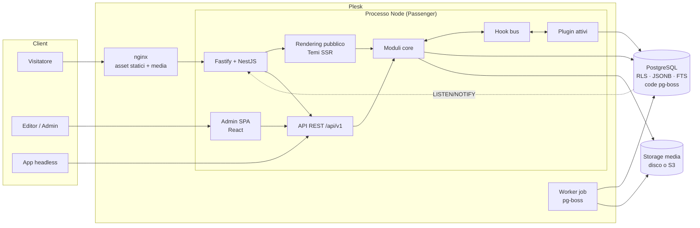
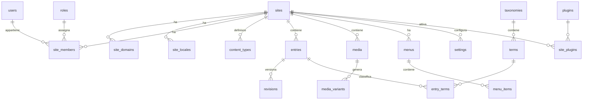
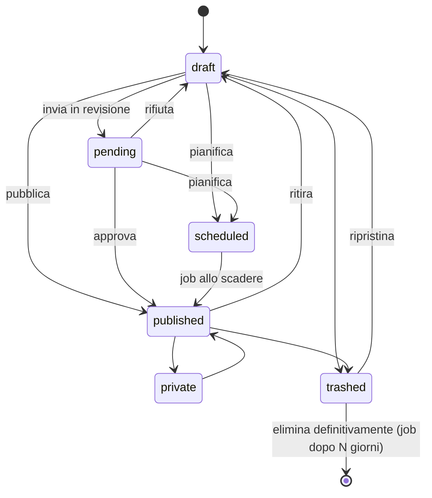
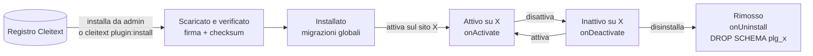
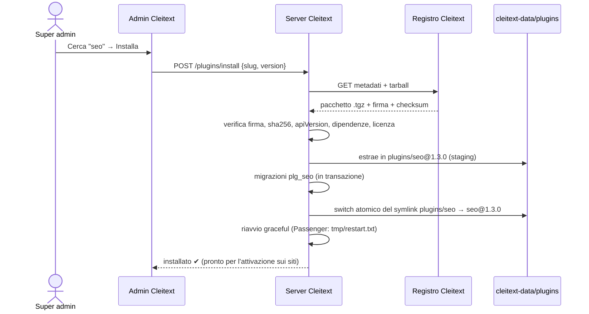

# Cleitext — Documento di architettura

> 🇬🇧 Versione di riferimento in inglese: [docs/ARCHITECTURE.md](../ARCHITECTURE.md). Questa traduzione è secondaria e può essere meno aggiornata.

> Versione 0.2 · ottobre 2026 · stato: **bozza per revisione del team**
> Nome di progetto: **cleitext** · Licenza: **GPL-2.0-or-later** (come WordPress)
> **Fase attuale: uso interno.** Inizialmente Cleitext serve ai nostri siti e non viene distribuito. Registro pubblico e dominio sono rinviati alla fase di apertura (vedi §11.9 e SPECIFICHE M7).
> Il nome unisce _Cleito_ (il CMS da cui nasce) e _text_: contenuti, blocchi e plugin.

---

## Indice

1. [Visione e principi](#1-visione-e-principi)
2. [Obiettivi di qualità e vincoli](#2-obiettivi-di-qualità-e-vincoli)
3. [Stack tecnologico](#3-stack-tecnologico)
4. [Vista d'insieme](#4-vista-dinsieme)
5. [Struttura del monorepo](#5-struttura-del-monorepo)
6. [Moduli del core](#6-moduli-del-core)
7. [Modello dati PostgreSQL](#7-modello-dati-postgresql)
8. [Multi-sito e isolamento (RLS)](#8-multi-sito-e-isolamento-rls)
9. [Modello dei contenuti](#9-modello-dei-contenuti)
10. [Editor e blocchi](#10-editor-e-blocchi)
11. [Sistema a plugin](#11-sistema-a-plugin)
12. [Temi e rendering pubblico](#12-temi-e-rendering-pubblico)
13. [API](#13-api)
14. [Sicurezza](#14-sicurezza)
15. [Prestazioni e cache](#15-prestazioni-e-cache)
16. [Job in background](#16-job-in-background)
17. [WordPress come modello, non come codice](#17-wordpress-come-modello-non-come-codice)
18. [Deploy: Plesk](#18-deploy-plesk)
19. [Osservabilità, test e qualità](#19-osservabilità-test-e-qualità)
20. [Registro delle decisioni (ADR)](#20-registro-delle-decisioni-adr)
21. [Rischi e mitigazioni](#21-rischi-e-mitigazioni)
22. [Decisioni prese e domande aperte](#22-decisioni-prese-e-domande-aperte)

---

## 1. Visione e principi

**Cleitext è un CMS open source che si usa come WordPress ma non è costruito su WordPress.**

WordPress è il **modello concettuale e di esperienza**: interfaccia, editor a blocchi Gutenberg, tipi di contenuto, tassonomie, temi, plugin, hook. Il codice invece è interamente nostro: TypeScript, PostgreSQL, architettura moderna.

All'inizio l'editor **è Gutenberg**, usato come libreria standalone. Il sistema è però progettato perché un domani **l'editor si possa sostituire** con un altro senza toccare contenuti, database, rendering pubblico o plugin lato server (vedi §10).

### Principi guida

| #   | Principio                                   | Cosa significa in pratica                                                                                                                                                                                                                |
| --- | ------------------------------------------- | ---------------------------------------------------------------------------------------------------------------------------------------------------------------------------------------------------------------------------------------- |
| P1  | **WordPress come modello, non come codice** | Stessi concetti ed esperienza d'uso, implementazione propria. Il core usa una nomenclatura propria (_entry_, non _post_).                                                                                                                |
| P2  | **Editor sostituibile**                     | Gutenberg è un _adattatore_ dietro l'interfaccia `EditorAdapter`. I contenuti sono salvati nel formato Cleitext (**CXD**), non nel markup di Gutenberg. Cambiare editor significa scrivere un nuovo adattatore, non migrare i contenuti. |
| P3  | **Core piccolo, tutto il resto plugin**     | Il core gestisce siti, utenti, contenuti, media, menu, temi e plugin. Form, SEO avanzata e commenti sono plugin.                                                                                                                         |
| P4  | **L'API dei plugin è il prodotto**          | Contratto versionato con semver, documentato e testato. Romperlo ha un costo esplicito.                                                                                                                                                  |
| P5  | **Sicuro per impostazione predefinita**     | Isolamento tra siti nel database, permessi granulari, upload non eseguibili, nessun segreto nel codice.                                                                                                                                  |
| P6  | **PostgreSQL al massimo**                   | JSONB, full-text, RLS, LISTEN/NOTIFY, code dei job: niente Redis o Elasticsearch obbligatori.                                                                                                                                            |
| P7  | **Monolite modulare**                       | Un solo processo deployabile, moduli con confini netti. Si potrà scomporre se e quando servirà.                                                                                                                                          |
| P8  | **Tipi end-to-end**                         | Schemi Zod condivisi tra database, API, admin e plugin.                                                                                                                                                                                  |

### Cosa _non_ è Cleitext

- Non è un fork di WordPress e non contiene codice PHP di WordPress. Usa solo i pacchetti JavaScript dell'editor Gutenberg (`@wordpress/block-editor` & co.), isolati nell'adattatore.
- Non è un "headless puro": ha un rendering pubblico server-side con temi, e un'API completa per chi lo usa headless.
- Non punta a eseguire plugin o temi WordPress esistenti.

---

## 2. Obiettivi di qualità e vincoli

| Attributo               | Obiettivo misurabile                                                                                                  |
| ----------------------- | --------------------------------------------------------------------------------------------------------------------- |
| **Efficienza**          | Pagina pubblica in cache: TTFB p95 < 50 ms. Senza cache: < 300 ms. API admin p95 < 150 ms con 50.000 entry per sito.  |
| **Sicurezza**           | Zero dati tra siti diversi (test automatici di isolamento). OWASP ASVS livello 2 come riferimento.                    |
| **Stabilità**           | Semver sul core e sull'API dei plugin, deprecazioni che durano almeno 2 minor, migrazioni sempre in avanti e testate. |
| **Modularità**          | Ogni funzione non essenziale è un plugin disattivabile senza rompere il core.                                         |
| **Footprint**           | Meno di 300 MB di RAM per processo. Un'istanza gestisce almeno 100 siti.                                              |
| **Accessibilità admin** | WCAG 2.1 AA.                                                                                                          |

**Vincoli:**

- Database: **PostgreSQL** (16 minimo, consigliato 17+).
- Hosting di riferimento: **Plesk con estensione Node.js** (Phusion Passenger). Docker per ora **non** fa parte del progetto.
- Runtime: **Node.js 24 LTS** (minimo 22 LTS).
- Licenza: **GPL-2.0-or-later**, la stessa di WordPress e dei pacchetti Gutenberg. Il modello dei plugin è quello di WordPress (§11.10). Le dipendenze devono avere licenze compatibili con la GPL, e un license-checker lo verifica in CI.

---

## 3. Stack tecnologico

| Livello            | Scelta                                                                                                                                                     | Motivazione                                                                                                           | Alternative scartate                                                                                                             |
| ------------------ | ---------------------------------------------------------------------------------------------------------------------------------------------------------- | --------------------------------------------------------------------------------------------------------------------- | -------------------------------------------------------------------------------------------------------------------------------- |
| Linguaggio         | **TypeScript** (strict)                                                                                                                                    | Un solo linguaggio per server, admin, editor e plugin.                                                                | PHP (scelta valida, ma due linguaggi), Go/Rust (plugin dinamici difficili)                                                       |
| Framework server   | **NestJS con adapter Fastify**                                                                                                                             | Moduli, dependency injection, guard e interceptor per la modularità; Fastify per le prestazioni.                      | Fastify puro (architettura da costruire a mano), Express (più lento)                                                             |
| ORM / query        | **Drizzle ORM** + `postgres` (driver)                                                                                                                      | Tipi forti, SQL trasparente, ottimo supporto a JSONB.                                                                 | Prisma (motore separato, meno controllo SQL), TypeORM                                                                            |
| Validazione        | **Zod**                                                                                                                                                    | Schemi condivisi tra API, admin e plugin, con generazione OpenAPI.                                                    | class-validator (solo lato server)                                                                                               |
| Editor             | **Gutenberg standalone** (`@wordpress/block-editor`, `@wordpress/components`, blocchi selezionati di `@wordpress/block-library`) dietro un `EditorAdapter` | Esperienza WordPress identica da subito, ecosistema maturo, accessibile. Il formato salvato (CXD) resta indipendente. | Lexical/Tiptap con livello blocchi custom (mesi di lavoro per ottenere la stessa UX): restano candidati per un futuro adattatore |
| Admin UI           | **React + Vite + Tailwind + shadcn/ui (Radix)**                                                                                                            | Componenti accessibili e nostri, nessun lock-in.                                                                      | MUI/Ant (look imposto)                                                                                                           |
| Dati admin         | **TanStack Query + TanStack Router**                                                                                                                       | Cache client e routing tipizzato.                                                                                     | Redux, React Router                                                                                                              |
| Rendering pubblico | **React SSR** (solo server, senza idratazione di default)                                                                                                  | Temi in TSX tipizzati, stesse competenze dell'admin, "isole" interattive opzionali.                                   | Eta/Nunjucks/Liquid (scartati: decisione presa, temi in React)                                                                   |
| Job                | **pg-boss** (code su PostgreSQL)                                                                                                                           | Nessun Redis, transazionale con i dati.                                                                               | BullMQ (richiede Redis)                                                                                                          |
| Immagini           | **sharp**                                                                                                                                                  | Varianti AVIF/WebP veloci.                                                                                            | ImageMagick                                                                                                                      |
| Password           | **argon2id** (`@node-rs/argon2`)                                                                                                                           | Standard attuale.                                                                                                     | bcrypt                                                                                                                           |
| Log                | **pino**                                                                                                                                                   | Log strutturati e veloci, nativi in Fastify.                                                                          | winston                                                                                                                          |
| Monorepo           | **pnpm + Turborepo**                                                                                                                                       | Workspace e build incrementali.                                                                                       | Nx (più pesante)                                                                                                                 |
| Test               | **Vitest, Playwright, PostgreSQL embedded**                                                                                                                | Unit, end-to-end e PostgreSQL reale senza container.                                                                  | Jest, Testcontainers (richiede Docker)                                                                                           |

---

## 4. Vista d'insieme



**Flusso di una richiesta pubblica:**

1. nginx serve direttamente asset e media, senza passare da Node.
2. Fastify risolve il **sito dall'host** (`site_domains`) e apre una transazione con `SET LOCAL app.site_id`.
3. Controlla la cache di pagina: se c'è un _hit_, risponde subito.
4. Il router dei contenuti risolve permalink → entry (rispettando le `redirects`).
5. La gerarchia di template del tema sceglie il template, l'albero dei blocchi viene trasformato in HTML e i filtri dei plugin sono applicati.
6. La risposta viene salvata in cache con i tag (`entry:<id>`, `menu:<id>`, `type:<slug>`).

---

## 5. Struttura del monorepo

```
cleitext/
├─ apps/
│  ├─ server/              # bootstrap NestJS+Fastify, composizione moduli, config
│  ├─ admin/               # SPA React (Vite) — servita da /admin
│  └─ worker/              # entrypoint del worker job (stesso codice, ruolo diverso)
├─ packages/
│  ├─ core/                # moduli core (sites, users, content, media, menus, settings…)
│  ├─ db/                  # schema Drizzle, migrazioni core, helper RLS
│  ├─ shared/              # schemi Zod, tipi, errori, costanti condivise
│  ├─ hooks/               # hook bus tipizzato (actions/filters)
│  ├─ plugin-sdk/          # API pubblica per gli autori di plugin (server)
│  ├─ admin-sdk/           # API pubblica per estendere l'admin (React)
│  ├─ blocks/              # formato CXD, registry blocchi, blocchi core
│  ├─ editor-core/         # interfaccia EditorAdapter, schermata editor agnostica (documento, salvataggio, pannelli)
│  ├─ editor-gutenberg/    # adattatore Gutenberg: CXD ⇄ blocchi Gutenberg, registrazione blocchi, media, link
│  ├─ registry-client/     # client del registro Cleitext (ricerca, download, verifica firme)
│  ├─ theme-sdk/           # API per i temi (template hierarchy, helper)
│  ├─ renderer/            # SSR pubblico, cache di pagina
│  └─ cli/                 # comando `cleitext`
├─ plugins/                # plugin ufficiali (stesso contratto dei plugin di terzi)
│  ├─ seo/
│  ├─ forms/
│  ├─ redirects-ui/
│  ├─ wp-import/           # importatore WXR
│  ├─ wp-compat/           # API REST compatibile WP (sottoinsieme), permalink WP
│  └─ cleito-import/       # migrazione dal vecchio Cleito CMS
├─ themes/
│  └─ aurora/              # tema predefinito
├─ tools/
│  └─ dev-db/              # PostgreSQL locale per lo sviluppo (binari embedded)
└─ docs/
```

**Regole di dipendenza**, verificate in CI con `eslint-plugin-boundaries`:

- `packages/core` **non** importa mai da `plugins/*` né da `themes/*`.
- I plugin importano **solo** da `plugin-sdk`, `admin-sdk`, `blocks`, `shared`, mai dall'interno di `core`.
- **Gli import da `@wordpress/*` sono consentiti solo in `packages/editor-gutenberg` e nei file `*.gutenberg.tsx` dei blocchi.** Server, renderer, core, temi e plugin lato server non li importano mai. È questa regola a rendere l'editor sostituibile.

---

## 6. Moduli del core

Ogni modulo è un modulo NestJS con un **servizio pubblico** (esposto ai plugin tramite l'SDK) e un **repository** interno (Drizzle). I moduli non leggono le tabelle degli altri moduli: comunicano tramite servizi ed eventi.

| Modulo       | Responsabilità                                                          |
| ------------ | ----------------------------------------------------------------------- |
| `sites`      | Siti, domini, lingue attive, risoluzione dell'host, contesto tenant.    |
| `identity`   | Utenti, sessioni, 2FA, passkey, token API, reset password.              |
| `access`     | Ruoli, capability, guard, policy per entry (proprietario/altri).        |
| `content`    | Tipi di contenuto, entry, revisioni, stati, pianificazione, traduzioni. |
| `taxonomy`   | Tassonomie e termini (categorie, tag, personalizzate).                  |
| `media`      | Upload, validazione, storage astratto (disco o S3), varianti immagine.  |
| `navigation` | Menu, voci di menu, posizioni dei menu del tema.                        |
| `settings`   | Impostazioni tipizzate per namespace (core e plugin).                   |
| `routing`    | Permalink, redirect, risoluzione URL → risorsa.                         |
| `search`     | Indicizzazione full-text per lingua.                                    |
| `themes`     | Registro temi, tema attivo per sito, impostazioni del tema.             |
| `plugins`    | Scoperta, ciclo di vita, migrazioni e attivazione per sito.             |
| `audit`      | Registro delle azioni (chi, cosa, quando, da dove).                     |
| `jobs`       | Facciata su pg-boss, job pianificati (cron).                            |
| `cache`      | Cache di pagina con tag e invalidazione cross-processo.                 |

---

## 7. Modello dati PostgreSQL

### 7.1 Convenzioni

- Chiavi primarie **UUID v7** (ordinabili nel tempo), generate dall'applicazione.
- `timestamptz` ovunque e tempi in UTC.
- Ogni tabella tenant ha `site_id uuid not null` con RLS attiva (vedi §8).
- Schema `public` per il core, **uno schema PostgreSQL per ogni plugin** (`plg_<slug>`), schema `pgboss` per le code.
- Estensioni: `citext`, `unaccent`, `pg_trgm`.
- Nessuna tabella stile "meta" chiave/valore: i campi personalizzati vanno in `JSONB`, validati da Zod e indicizzati dove serve.

### 7.2 Diagramma



### 7.3 DDL di riferimento (core)

```sql
create extension if not exists citext;
create extension if not exists unaccent;
create extension if not exists pg_trgm;

-- ===== Siti =====
create table sites (
  id              uuid primary key,
  slug            text not null unique,
  name            text not null,
  status          text not null default 'active' check (status in ('active','maintenance','archived')),
  default_locale  text not null default 'it',
  timezone        text not null default 'Europe/Rome',
  theme_slug      text,
  created_at      timestamptz not null default now()
);

create table site_domains (
  id          uuid primary key,
  site_id     uuid not null references sites(id) on delete cascade,
  host        citext not null unique,          -- risoluzione tenant per host
  is_primary  boolean not null default false,
  force_https boolean not null default true
);

create table site_locales (
  site_id     uuid not null references sites(id) on delete cascade,
  code        text not null,                   -- BCP 47: 'it', 'en', 'de-CH'
  name        text not null,
  is_default  boolean not null default false,
  position    int  not null default 0,
  url_prefix  text,                            -- es. '/en' ; null per la lingua di default
  primary key (site_id, code)
);

-- ===== Identità e accessi =====
create table users (
  id             uuid primary key,
  email          citext not null unique,
  display_name   text not null,
  password_hash  text,                         -- argon2id; null se solo passkey/SSO
  status         text not null default 'active' check (status in ('active','invited','suspended')),
  totp_secret    text,                         -- cifrato a livello applicativo
  locale         text not null default 'it',
  created_at     timestamptz not null default now(),
  last_login_at  timestamptz
);

create table roles (
  id            uuid primary key,
  site_id       uuid references sites(id) on delete cascade,  -- null = ruolo di sistema
  slug          text not null,
  name          text not null,
  capabilities  text[] not null default '{}',
  unique (site_id, slug)
);

create table site_members (
  site_id  uuid not null references sites(id) on delete cascade,
  user_id  uuid not null references users(id) on delete cascade,
  role_id  uuid not null references roles(id),
  primary key (site_id, user_id)
);

create table sessions (
  id          text primary key,                -- hash del token di sessione
  user_id     uuid not null references users(id) on delete cascade,
  expires_at  timestamptz not null,
  ip          inet,
  user_agent  text,
  created_at  timestamptz not null default now()
);

create table api_tokens (
  id           uuid primary key,
  site_id      uuid not null references sites(id) on delete cascade,
  user_id      uuid references users(id) on delete cascade,
  name         text not null,
  token_hash   text not null unique,
  scopes       text[] not null,
  expires_at   timestamptz,
  last_used_at timestamptz
);

-- ===== Contenuti =====
create table content_types (
  id            uuid primary key,
  site_id       uuid not null references sites(id) on delete cascade,
  slug          text not null,                 -- 'page', 'article', 'event'…
  name          jsonb not null,                -- etichette per lingua
  source        text not null default 'core',  -- 'core' | 'user' | 'plugin:<slug>'
  hierarchical  boolean not null default false,
  supports      text[] not null default '{title,blocks,revisions}',
  fields_schema jsonb not null default '{}',   -- definizione campi (vedi SPECIFICHE)
  permalink     text not null default '/{slug}',
  unique (site_id, slug)
);

create table entries (
  id                     uuid primary key,
  site_id                uuid not null references sites(id) on delete cascade,
  type_slug              text not null,
  locale                 text not null,
  translation_group      uuid not null,        -- stesse entry in lingue diverse
  parent_id              uuid references entries(id) on delete set null,
  slug                   text not null,
  title                  text not null default '',
  status                 text not null default 'draft'
                         check (status in ('draft','pending','scheduled','published','private','trashed')),
  author_id              uuid references users(id) on delete set null,
  current_revision_id    uuid,                 -- ultima revisione salvata
  published_revision_id  uuid,                 -- revisione visibile al pubblico
  published_at           timestamptz,
  scheduled_at           timestamptz,
  position               int not null default 0,
  search                 tsvector,             -- aggiornato all'atto della pubblicazione
  created_at             timestamptz not null default now(),
  updated_at             timestamptz not null default now(),
  trashed_at             timestamptz,
  unique (site_id, type_slug, locale, slug)
);
create index entries_list_idx on entries (site_id, type_slug, status, published_at desc);
create index entries_tgroup_idx on entries (translation_group);
create index entries_search_idx on entries using gin (search);

create table revisions (
  id              uuid primary key,
  site_id         uuid not null references sites(id) on delete cascade,
  entry_id        uuid not null references entries(id) on delete cascade,
  kind            text not null default 'manual' check (kind in ('manual','autosave','import','restore')),
  title           text not null,
  fields          jsonb not null default '{}',  -- campi personalizzati validati
  document        jsonb not null,               -- Cleitext Document (CXD)
  schema_version  int  not null,                -- versione del formato CXD
  author_id       uuid references users(id) on delete set null,
  created_at      timestamptz not null default now()
);
create index revisions_entry_idx on revisions (entry_id, created_at desc);

-- ===== Tassonomie =====
create table taxonomies (
  id             uuid primary key,
  site_id        uuid not null references sites(id) on delete cascade,
  slug           text not null,
  name           jsonb not null,
  hierarchical   boolean not null default false,
  content_types  text[] not null default '{}',
  unique (site_id, slug)
);

create table terms (
  id                 uuid primary key,
  site_id            uuid not null references sites(id) on delete cascade,
  taxonomy_id        uuid not null references taxonomies(id) on delete cascade,
  locale             text not null,
  translation_group  uuid not null,
  parent_id          uuid references terms(id) on delete set null,
  slug               text not null,
  name               text not null,
  description        text,
  fields             jsonb not null default '{}',
  unique (taxonomy_id, locale, slug)
);

create table entry_terms (
  entry_id  uuid not null references entries(id) on delete cascade,
  term_id   uuid not null references terms(id) on delete cascade,
  site_id   uuid not null,
  position  int not null default 0,
  primary key (entry_id, term_id)
);

-- ===== Media =====
create table media (
  id           uuid primary key,
  site_id      uuid not null references sites(id) on delete cascade,
  storage_key  text not null,                  -- percorso nello storage (mai il nome originale)
  filename     text not null,                  -- nome originale, solo come metadato
  mime         text not null,                  -- verificato con i magic bytes
  size_bytes   bigint not null,
  width        int,
  height       int,
  checksum     text not null,                  -- sha256, per la deduplicazione
  alt          jsonb not null default '{}',    -- testo alternativo per lingua
  caption      jsonb not null default '{}',
  focal_point  jsonb,
  uploaded_by  uuid references users(id) on delete set null,
  created_at   timestamptz not null default now()
);

create table media_variants (
  media_id     uuid not null references media(id) on delete cascade,
  site_id      uuid not null,
  variant      text not null,                  -- 'thumb', 'md', 'lg', 'xl'
  format       text not null,                  -- 'avif', 'webp', 'jpeg'
  storage_key  text not null,
  width        int not null,
  height       int not null,
  size_bytes   bigint not null,
  primary key (media_id, variant, format)
);

-- ===== Navigazione =====
create table menus (
  id        uuid primary key,
  site_id   uuid not null references sites(id) on delete cascade,
  slug      text not null,
  name      text not null,
  locale    text not null,
  location  text,                              -- posizione del tema: 'primary', 'footer'…
  unique (site_id, slug, locale)
);

create table menu_items (
  id         uuid primary key,
  site_id    uuid not null,
  menu_id    uuid not null references menus(id) on delete cascade,
  parent_id  uuid references menu_items(id) on delete cascade,
  position   int not null default 0,
  kind       text not null check (kind in ('entry','term','url','custom')),
  entry_id   uuid references entries(id) on delete cascade,
  term_id    uuid references terms(id) on delete cascade,
  url        text,
  label      text,                              -- se null si usa il titolo dell'entry o del termine
  target     text,
  attrs      jsonb not null default '{}'
);

-- ===== Impostazioni, routing, plugin, audit =====
create table settings (
  site_id    uuid not null references sites(id) on delete cascade,
  namespace  text not null,                    -- 'core', 'theme', 'plugin:seo'
  key        text not null,
  value      jsonb not null,
  primary key (site_id, namespace, key)
);

create table redirects (
  id         uuid primary key,
  site_id    uuid not null references sites(id) on delete cascade,
  from_path  text not null,
  to_path    text not null,
  status     int  not null default 301 check (status in (301,302,307,308,410)),
  hits       bigint not null default 0,
  unique (site_id, from_path)
);

create table plugins (                         -- installazione globale (codice presente)
  slug          text primary key,
  version       text not null,
  api_version   text not null,
  installed_at  timestamptz not null default now(),
  manifest      jsonb not null
);

create table site_plugins (                    -- attivazione per sito
  site_id      uuid not null references sites(id) on delete cascade,
  plugin_slug  text not null references plugins(slug) on delete cascade,
  active       boolean not null default false,
  activated_at timestamptz,
  primary key (site_id, plugin_slug)
);

create table plugin_migrations (
  plugin_slug  text not null,
  migration    text not null,
  checksum     text not null,
  applied_at   timestamptz not null default now(),
  primary key (plugin_slug, migration)
);

create table audit_log (
  id           bigint generated always as identity primary key,
  site_id      uuid,
  user_id      uuid,
  action       text not null,                  -- 'entry.publish', 'user.login.failed'…
  target_type  text,
  target_id    text,
  meta         jsonb not null default '{}',
  ip           inet,
  created_at   timestamptz not null default now()
);
create index audit_site_time_idx on audit_log (site_id, created_at desc);
```

> Il DDL qui sopra è il **riferimento concettuale**. La fonte di verità sarà lo schema Drizzle in `packages/db`, da cui si generano le migrazioni.

---

## 8. Multi-sito e isolamento (RLS)

Il vecchio Cleito usava `site_id` in ogni tabella, e l'idea resta valida. La differenza è che **l'isolamento viene imposto dal database**, non affidato alla disciplina di chi scrive il codice.

```sql
-- Ruolo applicativo: NON proprietario delle tabelle, NON superuser
create role cleitext_app login;

alter table entries enable row level security;
alter table entries force row level security;

create policy tenant_isolation on entries
  using      (site_id = current_setting('app.site_id', true)::uuid)
  with check (site_id = current_setting('app.site_id', true)::uuid);
-- (stessa policy generata per ogni tabella con site_id, tramite migrazione)
```

**Ciclo per ogni richiesta:**

1. Fastify `onRequest` risolve `Host` → `site_domains` → `site_id`, con una cache in memoria invalidata via NOTIFY.
2. Apre una transazione ed esegue `SET LOCAL app.site_id = '<uuid>'`. `SET LOCAL` è sicuro anche con il connection pooling, perché vale solo per la transazione.
3. Tutte le query della richiesta passano da quella transazione (`AsyncLocalStorage` porta il contesto).
4. Le operazioni cross-sito (super amministratore, CLI, migrazioni) usano un ruolo separato `cleitext_admin` con `BYPASSRLS`, e solo in percorsi di codice espliciti e messi a log nell'audit.

**Test obbligatori:** una suite dedicata crea due siti e verifica che nessun endpoint e nessun servizio restituisca dati dell'altro sito (`packages/db/test/tenant-isolation.test.ts`).

**Note d'implementazione** (`packages/db/drizzle/0001_tenant_rls.sql`):

- Il sito corrente si legge con `cleitext_current_site_id()`, che trasforma un'impostazione vuota in `NULL`. Dopo una transazione con `SET LOCAL`, l'impostazione torna a `''` (non a `NULL`) e non deve far fallire le query successive sulla stessa connessione del pool.
- Le tabelle tenant hanno il `FORCE`. `sites`, `site_domains`, `users` e `roles` hanno la RLS attiva ma senza `FORCE`, perché le gestisce il proprietario (CLI, installer). Il ruolo applicativo non è mai proprietario delle tabelle, quindi è sempre soggetto alle policy.
- La risoluzione dell'host avviene prima che esista un contesto di sito, tramite la funzione `SECURITY DEFINER` `cleitext_resolve_site(host)`, che restituisce solo l'id del sito.
- I controlli delle chiavi esterne ignorano la RLS. Per questo le righe figlie puntano ai genitori con **chiavi esterne composte `(site_id, id)`**: una riga del sito A non può mai riferirsi a una riga del sito B.
- Gli `users` sono globali: l'applicazione vede solo i membri del sito corrente. I `roles` con `site_id IS NULL` sono ruoli di sistema, leggibili da tutti i siti e modificabili solo dal proprietario.
- I privilegi del ruolo applicativo si concedono con `cleitext_grant_app(role)`, eseguita dopo ogni migrazione.

---

## 9. Modello dei contenuti

### 9.1 Concetti

- **Tipo di contenuto** (`content_types`): definisce i campi personalizzati (`fields_schema`), le funzioni supportate (blocchi, estratto, immagine in evidenza, gerarchia, revisioni) e il permalink. I tipi `page` e `article` sono creati dal core. Gli altri si creano dall'admin oppure li registrano i plugin.
- **Entry**: l'istanza di un contenuto, in **una lingua**.
- **Revisione**: istantanea immutabile di titolo, campi e documento a blocchi.
- **Gruppo di traduzione**: collega le entry che rappresentano lo stesso contenuto in lingue diverse.

### 9.2 Ciclo di vita



- **Salvataggio** = nuova revisione `manual` + `current_revision_id` aggiornato.
- **Autosave** ogni 30 secondi = revisione `autosave`. Ne viene conservata solo l'ultima per utente ed entry.
- **Pubblicazione** = `published_revision_id := current_revision_id`. Il pubblico vede _solo_ `published_revision_id`, quindi si possono modificare i contenuti pubblicati senza esporre le bozze.
- **Pulizia** delle revisioni: si conservano le ultime N (configurabile), le pubblicate e quelle con un'etichetta.

### 9.3 Campi personalizzati

Sono definiti in `fields_schema` con un DSL serializzabile in JSON e convertibile in Zod: `text`, `richtext`, `number`, `boolean`, `date`, `select`, `media`, `relation`, `repeater`, `group`, `json`. Valgono queste regole:

- validazione lato server **sempre**, anche se l'admin ha già validato;
- i campi marcati `indexed: true` generano un indice di espressione su `revisions.fields` / `entries` (tramite job di migrazione);
- l'admin genera automaticamente i form dei campi a partire dallo schema.

### 9.4 Lingue

- Ogni sito ha una o più lingue (`site_locales`), con prefisso URL opzionale (`/en/…`).
- Lo slug è per lingua. Gli `hreflang` si generano dal `translation_group`.
- Fallback configurabile: se una pagina non è tradotta si restituisce 404 oppure la versione nella lingua di default.

---

## 10. Editor e blocchi

### 10.0 Principio: Gutenberg oggi, editor sostituibile domani

L'editor iniziale è **Gutenberg**, nella sua versione standalone come libreria React: `@wordpress/block-editor`, `@wordpress/components`, `@wordpress/blocks` e una selezione di blocchi di `@wordpress/block-library`. L'utente ritrova esattamente l'esperienza di WordPress: inserter, toolbar, inspector, vista elenco, pattern.

Gutenberg però è **un adattatore, non il cuore del sistema**:

```mermaid
flowchart LR
    subgraph Indipendente["Indipendente dall'editor"]
        DB[(PostgreSQL<br/>revisions.document = CXD)]
        API[API /entries]
        R[Renderer SSR<br/>render() dei blocchi]
        BD[Definizioni blocchi<br/>tipo · schema Zod · render]
    end
    subgraph Adattatori["Sostituibile"]
        EA{{EditorAdapter}}
        G[editor-gutenberg<br/>oggi]
        X[editor-xyz<br/>domani]
    end
    DB <--> API <--> EA
    EA --- G
    EA -.- X
    BD --> R
    BD --> G
```

**Cosa resta uguale se si cambia editor:** database, formato CXD, API, rendering pubblico, temi, logica server dei plugin, definizione dei blocchi (tipo, attributi, render, migrazioni).

**Cosa va riscritto:** il pacchetto adattatore e i componenti di _modifica_ dei blocchi (`*.gutenberg.tsx` → `*.<nuovo>.tsx`).

**Cosa NON usiamo di Gutenberg:**

- la serializzazione HTML con commenti `<!-- wp:paragraph -->`: salviamo CXD;
- le funzioni `save()` dei blocchi: l'HTML pubblico lo produce il nostro renderer;
- `@wordpress/core-data` e le chiamate alla REST API di WordPress: dati, media e link passano dalla nostra API tramite l'adattatore.

### 10.1 Cleitext Document (CXD)

Il **formato salvato** non è il markup di Gutenberg né lo stato interno di nessun editor. È un formato Cleitext, versionato e documentato:

```json
{
  "schema": 1,
  "blocks": [
    {
      "id": "b_01JA9X…",
      "type": "core/heading",
      "v": 1,
      "attrs": { "level": 2, "anchor": "intro" },
      "content": [{ "text": "Benvenuti " }, { "text": "a bordo", "marks": ["bold"] }]
    },
    {
      "id": "b_01JA9Y…",
      "type": "core/columns",
      "v": 1,
      "attrs": { "gap": "md" },
      "children": [{ "id": "…", "type": "core/column", "v": 1, "attrs": {}, "children": [/* … */] }]
    }
  ]
}
```

- `content`: testo inline come array di span con `marks` (bold, italic, link, code…), in stile Portable Text.
- `children`: blocchi annidati, per i blocchi contenitore.
- `v`: versione dello schema degli attributi **del singolo blocco**, usata per le migrazioni.

**Perché un formato proprio:** se domani si sostituisce Gutenberg, i contenuti restano validi e si riscrive solo l'adattatore. Il testo ricco, che in Gutenberg è una stringa HTML negli attributi (per esempio `content` di `core/paragraph`), viene convertito e sanificato in span `content` dall'adattatore in fase di salvataggio, e riconvertito in fase di caricamento.

**Nomi dei blocchi:** i blocchi core usano il namespace `core/` con gli stessi nomi di Gutenberg (`core/paragraph`, `core/columns`…). Così l'adattatore Gutenberg è quasi una mappatura uno a uno, ma il significato dei nomi è definito da Cleitext e non da WordPress.

### 10.2 L'interfaccia `EditorAdapter`

```ts
interface EditorAdapter {
  id: string; // 'gutenberg'
  mount(el: HTMLElement, opts: EditorMountOptions): EditorInstance;
}

interface EditorMountOptions {
  document: CxdDocument; // contenuto iniziale
  blocks: BlockDefinition[]; // blocchi disponibili (core + plugin)
  patterns: Pattern[];
  services: {
    // implementati da Cleitext, NON da WordPress
    uploadMedia(file: File): Promise<MediaRef>;
    searchLinks(q: string): Promise<LinkSuggestion[]>;
    getMedia(id: string): Promise<MediaView>;
    oembed(url: string): Promise<EmbedData>;
  };
  locale: string;
  readOnly?: boolean;
  onChange(doc: CxdDocument): void; // usato per autosave e stato "modificato"
}

interface EditorInstance {
  getDocument(): CxdDocument;
  insertBlocks(blocks: CxdBlock[]): void;
  undo(): void;
  redo(): void;
  destroy(): void;
}
```

La schermata di modifica (`editor-core`) è agnostica: barra superiore, pulsanti salva/pubblica, scheda _Documento_ dell'inspector con stato, tassonomie, campi e pannelli dei plugin. Solo l'area dei blocchi e la scheda _Blocco_ appartengono all'adattatore.

### 10.3 Definizione di un blocco

La definizione è **divisa in due parti**: una agnostica (server e renderer) e una per l'editor.

```ts
// blocks/hero/index.ts — agnostico: lo usano server, renderer e validazione
export default defineBlock({
  type: 'acme/hero',
  version: 2,
  title: { it: 'Hero', en: 'Hero' },
  category: 'layout',
  icon: 'cover',
  attrs: z.object({
    mediaId: z.string().uuid().optional(),
    overlay: z.number().min(0).max(1).default(0.4),
    align: z.enum(['left', 'center']).default('center'),
  }),
  allowedChildren: ['core/heading', 'core/paragraph', 'core/buttons'],
  migrate: { 1: (a) => ({ ...a, align: a.centered ? 'center' : 'left' }) },  // v1 → v2
  render: (ctx) => <Hero {...ctx.attrs}>{ctx.children}</Hero>,               // SSR pubblico
  editors: {
    gutenberg: () => import('./hero.gutenberg'),   // caricato solo nell'admin
  },
});
```

```tsx
// blocks/hero/hero.gutenberg.tsx — l'unico file che conosce Gutenberg
import { InnerBlocks, InspectorControls, MediaPlaceholder } from '@wordpress/block-editor';
import { PanelBody, RangeControl } from '@wordpress/components';

export default defineGutenbergEdit<'acme/hero'>(({ attributes, setAttributes }) => (
  <>
    <InspectorControls>
      <PanelBody title="Overlay">
        <RangeControl
          value={attributes.overlay}
          min={0}
          max={1}
          step={0.1}
          onChange={(overlay) => setAttributes({ overlay })}
        />
      </PanelBody>
    </InspectorControls>
    {/* … */}
    <InnerBlocks allowedBlocks={['core/heading', 'core/paragraph', 'core/buttons']} />
  </>
));
```

- L'adattatore registra il blocco in Gutenberg (`registerBlockType`) usando lo schema Zod per gli attributi, il componente `edit` e `save: () => null`. Il salvataggio passa sempre da CXD.
- **Un blocco senza componente per l'editor attivo** viene mostrato con un _form generato automaticamente dallo schema Zod_, quindi resta modificabile anche dopo un cambio di editor, prima che qualcuno riscriva il suo componente.
- Per i blocchi core si **riusano i componenti `edit` di `@wordpress/block-library`** dove possibile, con un renderer server scritto da noi.

### 10.4 Interfaccia dell'editor (Gutenberg)

- **Inserter** (pulsante "+" e ricerca rapida con `/`), blocchi divisi per categoria, pattern.
- **Toolbar del blocco**: sposta su/giù, trascina, trasforma in, duplica, elimina.
- **Inspector** (barra laterale destra), con due schede:
  - _Documento_: stato, pianificazione, permalink, tassonomie, immagine in evidenza, campi personalizzati, pannelli dei plugin.
  - _Blocco_: `InspectorControls` del blocco (Gutenberg), oppure un form generato dallo schema Zod.
- **Vista elenco** (struttura ad albero), annulla/ripeti, scorciatoie da tastiera.
- **Pattern**: insiemi di blocchi salvati e riutilizzabili. Esistono _pattern sincronizzati_ (l'equivalente dei blocchi riutilizzabili) e _pattern non sincronizzati_.
- **Anteprima** reale tramite il renderer del tema, con un token di anteprima temporaneo.

### 10.5 Blocchi del core (MVP)

`paragraph`, `heading`, `list`, `quote`, `image`, `gallery`, `buttons`/`button`, `columns`/`column`, `group`, `separator`, `spacer`, `embed` (YouTube/Vimeo/oEmbed), `html` (solo per chi ha la capability `unfiltered_html`), `table`, `code`.

Per ognuno servono una definizione agnostica (schema e render), un componente edit Gutenberg (riusato da `block-library` dove possibile) e i test di round-trip CXD ⇄ Gutenberg.

### 10.6 Note tecniche sull'integrazione Gutenberg

- **Peso**: Gutenberg è pesante, circa 1–2 MB gzip con le dipendenze. Va caricato **solo nella schermata di modifica** (lazy), mentre il resto dell'admin resta leggero.
- **Stili**: gli stili dell'editor sono isolati in un iframe di modifica (supportato dal block editor), così non entrano in conflitto con Tailwind dell'admin. Gli stili del tema attivo si iniettano nell'iframe per avere un'anteprima fedele (_editor styles_).
- **Versioni**: i pacchetti `@wordpress/*` vanno aggiornati **tutti insieme** e con una versione fissata. Ogni aggiornamento passa dai test di round-trip e dagli E2E dell'editor.
- **Riferimento**: progetti come _Isolated Block Editor_ (Automattic) mostrano l'uso di Gutenberg fuori da WordPress e sono utili come riferimento d'implementazione.

---

## 11. Sistema a plugin

### 11.1 Cos'è un plugin

Un plugin è un **pacchetto npm** (o una cartella in `plugins/`) che contiene un manifest e uno o più punti di ingresso:

```
plugins/seo/
├─ package.json
├─ cleitext.plugin.json        # manifest
├─ src/server/index.ts        # entry server (definePlugin)
├─ src/admin/index.tsx        # entry admin (opzionale, ESM)
├─ src/blocks/…               # blocchi (opzionale)
└─ migrations/                # SQL nello schema plg_seo
```

### 11.2 Manifest

```json
{
  "slug": "seo",
  "name": "Cleitext SEO",
  "version": "1.3.0",
  "apiVersion": "^1.0",
  "description": "Meta tag, Open Graph, sitemap, schema.org",
  "author": "Cleitext Team",
  "license": "GPL-2.0-or-later",
  "server": "dist/server/index.js",
  "admin": "dist/admin/index.js",
  "requires": { "plugins": { "forms": "^2.0" } },
  "capabilities": ["manage_seo"],
  "permissions": ["content:read", "settings:own", "http:outbound"],
  "settingsSchema": "dist/settings.schema.json"
}
```

### 11.3 Ciclo di vita



- **Install** (globale): dal registro, dall'upload di un pacchetto `.zip` o `.tgz` (come _Carica plugin_ di WordPress) o dal server di aggiornamento dello sviluppatore. Seguono la verifica di checksum, `apiVersion` e dipendenze (più la firma, se il pacchetto viene dal registro) e le migrazioni nello schema `plg_<slug>`. Si può fare **dall'admin** (super admin) o da CLI (§11.9).
- **Activate / Deactivate** (per sito): hook `onActivate` / `onDeactivate`. I dati restano.
- **Uninstall**: `onUninstall`, poi `DROP SCHEMA plg_<slug> CASCADE` e rimozione dei `settings` del namespace, con conferma esplicita.
- **Caricamento**: all'avvio il server legge i plugin installati, li importa (`import()`) e registra i loro moduli NestJS dinamici. **Installare o aggiornare un plugin richiede un riavvio graceful** del processo, che su Passenger si ottiene con `tmp/restart.txt`. Attivare o disattivare su un sito **non** richiede riavvio, perché gli hook si filtrano per sito a runtime.

### 11.4 Punto di ingresso server

```ts
import { definePlugin } from '@cleitext/plugin-sdk';

export default definePlugin({
  setup(ctx) {
    // Hook: action (evento) e filter (trasformazione), con priorità
    ctx.hooks.on('entry.published', async ({ entry }) => {
      await ctx.jobs.enqueue('seo.ping-sitemaps', { siteId: entry.siteId });
    });

    ctx.hooks.filter('render.head', (head, { entry }) => head.concat(buildMetaTags(entry)), {
      priority: 20,
    });

    // Estensioni dichiarative
    ctx.content.registerFieldGroup({ types: ['page', 'article'], fields: seoFields });
    ctx.routes.get('/sitemap.xml', sitemapHandler, { public: true, cache: '1h' });
    ctx.jobs.define('seo.ping-sitemaps', pingHandler);
    ctx.settings.define(seoSettingsSchema);
    ctx.access.defineCapability('manage_seo', { defaultRoles: ['admin', 'editor'] });
  },
  async onActivate(site) {
    /* … */
  },
  async onDeactivate(site) {
    /* … */
  },
  async onUninstall() {
    /* … */
  },
});
```

### 11.5 Hook tipizzati

Gli hook sono dichiarati con **declaration merging**, così TypeScript conosce i payload:

```ts
// nel core
declare module '@cleitext/hooks' {
  interface Actions {
    'entry.published': { entry: EntryView; site: SiteView };
    'user.login': { user: UserView; ip: string };
  }
  interface Filters {
    'render.head': [head: HeadTag[], ctx: { entry?: EntryView }];
    'entry.permalink': [url: string, ctx: { entry: EntryView }];
    'admin.menu': [items: AdminMenuItem[], ctx: { user: UserView }];
  }
}
// un plugin può dichiarare a sua volta hook propri con lo stesso meccanismo
```

**Regole del bus:**

- Le _action_ sono asincrone e possono essere sincrone in transazione (`'tx'`) oppure dopo il commit (`'afterCommit'`, il default).
- I _filter_ sono funzioni sincrone o asincrone in catena, eseguite in ordine di priorità.
- L'errore di un handler **viene messo a log e isolato**: non fa cadere la richiesta, salvo per gli hook marcati `critical`. Un plugin che continua a fallire viene disattivato automaticamente e il problema è segnalato in bacheca.
- Ogni handler ha un timeout configurabile. Il tempo speso da ciascun plugin è misurato e visibile in admin.

### 11.6 Accesso ai dati e permessi

- I plugin **non** ricevono il pool del database del core. Ricevono:
  - **servizi di facciata** del core (`ctx.content`, `ctx.media`, …), limitati ai `permissions` dichiarati nel manifest;
  - un'istanza Drizzle **ristretta al proprio schema** `plg_<slug>`, con un ruolo PostgreSQL dedicato che ha `USAGE` solo su quello schema e la RLS sempre attiva.
- **Limite onesto:** in Node un plugin è codice fidato. Non esiste un vero sandbox (potrebbe importare `fs`). I permessi servono a ridurre gli errori e a dare trasparenza all'installazione, non sono una barriera contro codice malevolo. L'installazione mostra quindi i permessi richiesti e, in futuro, l'origine verificata (firma del pacchetto).

### 11.7 Estensioni dell'admin

L'entry `admin` è un modulo ESM caricato a runtime. `react`, `react-dom` e `@cleitext/admin-sdk` sono condivisi tramite **import map**, quindi il plugin non li include nel proprio bundle. I punti di estensione sono:

- voci di menu e pagine dell'admin (rotte);
- widget della bacheca;
- pannelli nell'inspector del documento (per tipo di contenuto);
- blocchi dell'editor;
- schede nelle impostazioni (form generati da `settingsSchema` oppure componenti personalizzati);
- azioni di massa e colonne nelle tabelle elenco.

### 11.8 Versionamento dell'API dei plugin

- `@cleitext/plugin-sdk` segue semver. Ogni plugin dichiara `apiVersion`.
- Una deprecazione dura almeno **due minor**, con avviso in console e in admin.
- Una **suite di contratto** (test eseguiti contro i plugin ufficiali) gira in CI a ogni modifica del core.

### 11.9 Registro Cleitext e installazione dall'admin

> **Fasi.**
>
> - **Uso interno (ora):** i plugin si installano da cartella locale, da upload `.zip`/`.tgz` dall'admin o da CLI. Non c'è nessun registro online.
> - **Apertura pubblica (in futuro):** si attiva il registro descritto qui sotto. Il codice del core è già predisposto: il client del registro è un modulo separato (`registry-client`) e `REGISTRY_URL` è vuoto per default, quindi la sezione _Aggiungi nuovo_ mostra solo l'upload.

Nella fase pubblica plugin e temi si distribuiscono tramite un **registro proprio** (dominio da definire). Dall'admin il super admin li cerca, li installa e li aggiorna, come in _Plugin → Aggiungi nuovo_ di WordPress.



**Registro (servizio separato, anch'esso open source):**

- **API**: ricerca, metadati, versioni, download, statistiche anonime d'installazione. Pagina pubblica di ogni plugin con descrizione, screenshot, changelog, compatibilità e permessi richiesti.
- **Pubblicazione**: account sviluppatore, upload tramite CLI (`cleitext publish`), **revisione automatica** (manifest valido, build, scansione delle dipendenze, licenza compatibile, nessun codice offuscato) più una **revisione manuale** alla prima pubblicazione.
- **Pubblicazione aperta a tutti**, come la directory di WordPress.org: chiunque può pubblicare plugin e temi gratuiti con licenza compatibile con la GPL, dopo la revisione.
- **Firma**: ogni release del registro è firmata (Ed25519) e la chiave pubblica è inclusa nel core. Il pacchetto viene verificato prima dell'installazione.
- **Pacchetti esterni al registro** (upload manuale, plugin premium): si installano **come in WordPress**, con un avviso chiaro che il pacchetto non è verificato dal registro. Il super admin può vietarli con `PLUGINS_ALLOW_UNSIGNED=false`.
- **Revoca**: il registro può segnalare una versione come compromessa. Le installazioni la mostrano in admin e possono disattivarla automaticamente (configurabile).
- **Aggiornamenti**: controllo periodico (job) con notifica in admin, aggiornamenti con un clic e rollback alla versione precedente, che resta conservata.

**Sicurezza dell'installazione dall'admin:**

- serve la capability `manage_plugins`, che di default ha solo il super admin, con **2FA obbligatoria**;
- si può disattivare con `PLUGINS_INSTALL_FROM_UI=false`, per esempio negli ambienti gestiti tramite CI;
- i plugin stanno in `cleitext-data/plugins`, fuori dalla release, quindi sopravvivono ai deploy. È l'unica cartella di codice scrivibile dal processo;
- ogni operazione è registrata nell'audit log.

**Temi**: stesso registro, stesso flusso (`cleitext.theme.json`, firma, installazione dall'admin in _Aspetto → Temi_).

### 11.10 Licenza di plugin e temi

Il core è **GPL-2.0-or-later**, come WordPress, e adotta **lo stesso modello di licenza dei plugin**:

- plugin e temi girano nello stesso processo e usano l'SDK, quindi, come sostiene WordPress, il loro codice è considerato opera derivata e va distribuito con licenza **compatibile con la GPL** (GPL-2.0-or-later, GPL-3.0, oppure MIT, Apache-2.0 o BSD per il codice);
- il **registro** accetta solo plugin e temi gratuiti con licenza compatibile con la GPL, come WordPress.org;
- i **plugin premium** sono ammessi come in WordPress: si vendono sul sito dello sviluppatore (il codice resta sotto GPL, mentre si pagano supporto, aggiornamenti e servizi), si installano via upload e si aggiornano dal server dello sviluppatore (campo `updateSource` nel manifest). Asset come immagini, CSS o JavaScript del frontend possono avere licenze diverse, come in WordPress;
- i plugin ufficiali sono GPL-2.0-or-later.

> Se i plugin siano davvero "opere derivate" è una questione giuridica discussa. Cleitext adotta la stessa posizione di WordPress per coerenza con quel modello. Prima della 1.0 va fatta una verifica legale del testo della licenza e delle condizioni del registro.

### 11.11 Corrispondenza con il sistema plugin di WordPress

| WordPress                                                                              | Cleitext                                                                         |
| -------------------------------------------------------------------------------------- | -------------------------------------------------------------------------------- |
| Header del file principale del plugin (`Plugin Name`, `Version`, `Requires at least`…) | Manifest `cleitext.plugin.json` (`name`, `version`, `requires.cleitext`…)        |
| `register_activation_hook` / `register_deactivation_hook` / `uninstall.php`            | `onActivate` / `onDeactivate` / `onUninstall`                                    |
| `add_action` / `add_filter` / `do_action` / `apply_filters`, con priorità              | `hooks.on` / `hooks.filter` / `hooks.emit`, con priorità e tipi                  |
| _Plugin → Aggiungi nuovo_ (directory WordPress.org)                                    | _Plugin → Aggiungi nuovo_ (registro Cleitext)                                    |
| _Carica plugin_ (.zip)                                                                 | Upload `.zip` / `.tgz`                                                           |
| Aggiornamenti automatici per plugin (attivabili singolarmente)                         | Interruttore per plugin: aggiornamenti automatici sì/no                          |
| `Update URI` per plugin premium                                                        | `updateSource` nel manifest                                                      |
| Attivazione per sito e _Attiva sulla rete_ (multisite)                                 | Attivazione per sito e **attivazione su tutti i siti** (super admin)             |
| `mu-plugins` (sempre attivi)                                                           | Cartella `plugins-required/`: plugin sempre attivi, non disattivabili dall'admin |
| `add_menu_page`, `add_meta_box`, Settings API                                          | `admin-sdk`: `menu`, `documentPanels`, `settingsPages`                           |
| `register_post_type`, `register_taxonomy`                                              | `ctx.content.registerType`, `ctx.taxonomy.register`                              |
| `register_block_type`                                                                  | `defineBlock` (più il componente edit per Gutenberg)                             |
| `$wpdb` e tabelle con prefisso                                                         | Schema PostgreSQL dedicato `plg_<slug>` con Drizzle                              |
| WP-Cron                                                                                | Job pg-boss (`ctx.jobs.schedule`)                                                |
| Capability personalizzate (`add_cap`)                                                  | `ctx.access.defineCapability`                                                    |

**Differenze volute rispetto a WordPress** (per sicurezza e stabilità):

- hook tipizzati;
- isolamento degli errori dei plugin;
- schema DB separato per ogni plugin;
- facade con permessi dichiarati invece dell'accesso libero all'intero database;
- riavvio graceful dopo l'installazione: in Node il codice si carica all'avvio, non a ogni richiesta come in PHP.

---

## 12. Temi e rendering pubblico

### 12.1 Struttura di un tema

```
themes/aurora/
├─ cleitext.theme.json         # manifest: nome, versione, posizioni menu, aree, supporti
├─ templates/
│  ├─ layout.tsx              # shell HTML (head, header, footer)
│  ├─ index.tsx               # fallback generale
│  ├─ entry.tsx               # singola entry
│  ├─ entry-page.tsx          # singola entry di tipo "page"
│  ├─ archive.tsx             # elenchi
│  ├─ taxonomy-category.tsx
│  ├─ search.tsx
│  └─ 404.tsx
├─ blocks/                    # stili/override dei blocchi
├─ assets/                    # css/js compilati con Vite (Tailwind opzionale)
└─ settings.schema.ts         # impostazioni del tema → form automatico ("Personalizza")
```

### 12.2 Gerarchia dei template (in stile WordPress, semplificata)

Per una entry `article` con slug `ciao` si cerca, nell'ordine:

`entry-article-ciao` → `entry-article` → `entry` → `index`

Gli archivi e le tassonomie seguono lo stesso schema. Un plugin può aggiungere candidati tramite il filtro `theme.templateCandidates`.

### 12.3 Rendering

- I template sono componenti React renderizzati **solo sul server** (`renderToPipeableStream`). **Nessun JavaScript inviato di default.**
- **Isole interattive** opzionali: un blocco può dichiarare `island: true` e solo quel componente viene idratato nel browser.
- **Aree** del tema (header, footer, sidebar) composte a blocchi, al posto dei widget di WordPress.
- Gli helper dell'SDK del tema (`useEntry`, `useMenu('primary')`, `useSettings`, `asset()`, `image()` con `srcset`) sono disponibili nei template.

---

## 13. API

- **REST**, versionata `/api/v1`, con JSON. La documentazione **OpenAPI 3.1 è generata dagli schemi Zod** ed esposta su `/api/docs`.
- **L'admin usa esclusivamente l'API pubblica**: niente endpoint privati, così l'uso headless è garantito.
- **Autenticazione:**
  - Admin: **cookie di sessione** `HttpOnly; Secure; SameSite=Lax`, più un token CSRF (double submit) per i metodi che modificano i dati.
  - Headless e integrazioni: **token API** con scope (`Authorization: Bearer`), salvati come hash.
- **Delivery API** di sola lettura (`/api/v1/delivery/...`) per i frontend headless: espone solo contenuti pubblicati, ha cache e un rate limit dedicato.
- **Paginazione** a cursore, filtri tipizzati, `fields=` per le proiezioni, `include=` per le relazioni.
- **Errori** nel formato RFC 9457 (`application/problem+json`).
- **Webhook** in uscita, configurabili per evento e firmati con HMAC.

L'elenco completo degli endpoint è in `SPECIFICHE.md` §6.

---

## 14. Sicurezza

| Area       | Misura                                                                                                                                                                                                                                  |
| ---------- | --------------------------------------------------------------------------------------------------------------------------------------------------------------------------------------------------------------------------------------- |
| Password   | argon2id, policy minima di 12 caratteri, controllo contro password compromesse (k-anonymity HIBP, opzionale).                                                                                                                           |
| Login      | Rate limit per IP e per account, blocco progressivo, audit dei tentativi falliti.                                                                                                                                                       |
| 2FA        | TOTP e **passkey (WebAuthn)**. Obbligatoria per i ruoli amministrativi (configurabile).                                                                                                                                                 |
| Sessioni   | Token casuale da 256 bit, nel database salvato solo l'hash, rotazione al login e al cambio di privilegi, revoca da admin.                                                                                                               |
| CSRF       | Token double submit più controllo di `Origin` sulle richieste che modificano dati.                                                                                                                                                      |
| Permessi   | Capability granulari verificate da guard NestJS, più policy sulle risorse (proprietario/altri).                                                                                                                                         |
| Isolamento | RLS PostgreSQL per sito (§8), ruolo DB per plugin (§11.6).                                                                                                                                                                              |
| Upload     | Controllo del tipo reale (magic bytes) contro una whitelist, rinomina con UUID, storage fuori dalla root dell'app, servito da nginx **senza esecuzione**, `Content-Disposition` per i tipi non immagine, SVG sanificato o disabilitato. |
| HTML       | L'output dei blocchi è escapato di default. Il blocco `html` e i campi `richtext` sono sanificati (allowlist), salvo capability `unfiltered_html`.                                                                                      |
| Header     | CSP rigorosa (nonce), HSTS, `X-Content-Type-Options`, `Referrer-Policy`, `Permissions-Policy`.                                                                                                                                          |
| SSRF       | Le richieste in uscita (oEmbed, webhook, plugin) passano da un client che blocca IP privati e di loopback.                                                                                                                              |
| Segreti    | Solo variabili d'ambiente o file di configurazione fuori dal repository. I segreti nel database (TOTP, chiavi) sono cifrati con una chiave applicativa.                                                                                 |
| Dipendenze | `pnpm audit`, Renovate, SBOM (CycloneDX) a ogni release, release firmate.                                                                                                                                                               |
| Errori     | Nessuno stack trace in produzione. Id di correlazione nelle risposte di errore.                                                                                                                                                         |
| Audit      | Login, cambi di ruolo, pubblicazioni, installazioni di plugin, modifiche alle impostazioni.                                                                                                                                             |

---

## 15. Prestazioni e cache

- **Cache dell'intera pagina** per le richieste anonime, con chiave `site + host + path + lingua + varianti`. Due backend:
  - **memoria** (LRU per processo, il default su Plesk);
  - **disco** (file serviti direttamente da nginx, il massimo delle prestazioni).
- **Invalidazione a tag**: pubblicare un'entry invalida `entry:<id>`, i suoi archivi, i menu che la contengono e i feed. Le invalidazioni sono propagate tra processi con `NOTIFY cleitext_cache`.
- `ETag` e `Last-Modified` sulle risposte pubbliche, `Cache-Control` adeguato e asset con hash, cacheabili per un anno.
- **Immagini**: varianti generate in background al momento dell'upload, `srcset`/`sizes` automatici, AVIF/WebP con fallback.
- **Database**: indici mirati (§7.3), query di elenco solo su `entries`, mentre il caricamento del documento a blocchi avviene solo per la singola entry. Pool di connessioni dimensionato per processo.
- **Admin**: editor e blocchi caricati lazy, bundle iniziale sotto i 500 KB gzip.

---

## 16. Job in background

- **pg-boss** usa PostgreSQL (schema `pgboss`), quindi i job sono transazionali con i dati: un job accodato in una transazione annullata non parte.
- Job del core: pubblicazione programmata, generazione varianti immagine, pulizia revisioni e cestino, aggiornamento indice di ricerca, consegna dei webhook, invio email.
- **Due modalità**, pensate per Plesk:
  - `JOBS_MODE=worker`: processo worker separato (VPS con systemd). È la modalità consigliata.
  - `JOBS_MODE=inline`: il processo web elabora i job in background, per gli hosting dove non si può avviare un secondo processo. In più, un task pianificato di Plesk chiama `cleitext jobs:tick` ogni minuto come garanzia, perché Passenger può spegnere i processi inattivi.

---

## 17. WordPress come modello, non come codice

Cleitext deve **sembrare e funzionare come WordPress** per chi lo usa, ma è scritto da zero. La relazione con WordPress si articola su quattro livelli:

| Livello                   | Cosa                                              | Dove                                        |
| ------------------------- | ------------------------------------------------- | ------------------------------------------- |
| 1. Concetti ed esperienza | Stessi concetti, stessa organizzazione dell'admin | Core (con nomenclatura propria)             |
| 2. Editor                 | Gutenberg come libreria, **sostituibile**         | Adattatore `editor-gutenberg` (§10)         |
| 3. Migrazione             | Import da WordPress                               | Plugin `wp-import`                          |
| 4. Compatibilità API      | Sottoinsieme REST WP                              | Plugin `wp-compat` (opzionale, dopo la 1.0) |

### Livello 1 — Concetti ed esperienza (core, nomenclatura propria)

| WordPress                   | Cleitext                               | Note                                                                                   |
| --------------------------- | -------------------------------------- | -------------------------------------------------------------------------------------- |
| Post / Page                 | **Entry** di tipo `article` / `page`   | In admin le etichette restano "Articoli" e "Pagine".                                   |
| Custom post type            | **Content type**                       | Definibile anche da admin, non solo da codice.                                         |
| Post meta                   | **Fields** (JSONB validato)            | Niente tabella EAV.                                                                    |
| Taxonomy / Term             | Taxonomy / Term                        | Stesso concetto.                                                                       |
| Shortcode                   | **Blocco**                             |                                                                                        |
| Widget / Sidebar            | **Blocchi in un'area del tema**        |                                                                                        |
| Customizer                  | **Impostazioni tema** (form da schema) |                                                                                        |
| Options                     | **Settings** tipizzate per namespace   |                                                                                        |
| Roles & capabilities        | Roles & capabilities                   | Stessi nomi di ruolo (Amministratore, Editore, Autore, Collaboratore, Sottoscrittore). |
| `add_action` / `add_filter` | `hooks.on` / `hooks.filter`            | Tipizzati.                                                                             |
| Multisite                   | **Siti** (nativo, RLS)                 |                                                                                        |
| Template hierarchy          | Template hierarchy (semplificata)      |                                                                                        |

Il layout dell'admin richiama WordPress: barra laterale scura a sinistra, bacheca a widget, tabelle elenco con azioni di massa e modifica rapida, plugin e temi installabili dall'admin. L'editor è Gutenberg. **Il resto dell'interfaccia è nostro**: palette, tipografia e componenti di Cleitext (React + Tailwind + shadcn/ui).

### Livello 2 — Editor Gutenberg, sostituibile

Vedi §10. In sintesi: Gutenberg è usato come libreria dietro `EditorAdapter`. Il contenuto è salvato in CXD, l'HTML pubblico lo genera il nostro renderer e gli import da `@wordpress/*` sono confinati da una regola lint. **Per cambiare editor un domani:**

1. si implementa un nuovo `EditorAdapter` (per esempio basato su Lexical, Tiptap o un editor nostro);
2. si scrivono i componenti di modifica dei blocchi per il nuovo editor. Nel frattempo i blocchi senza componente restano modificabili con il form generato dallo schema;
3. si cambia l'impostazione `editor.adapter`, anche per sito, così da poter fare una migrazione graduale;
4. **nessuna migrazione dei dati**: database, API, renderer, temi e plugin lato server restano invariati.

### Livello 3 — Migrazione (plugin `wp-import`)

- Import di file **WXR** (export di WordPress): articoli, pagine, tipi personalizzati, tassonomie, menu, autori, media (scaricati e ri-ospitati).
- Conversione dei blocchi Gutenberg (commenti `<!-- wp:… -->`) in CXD. L'HTML classico diventa blocchi `paragraph`/`heading`/`image`, mentre tutto ciò che non è riconosciuto diventa un blocco `html`.
- Generazione automatica delle **redirect** dai permalink WordPress ai nuovi URL.
- Report finale dell'import con gli avvisi.

### Livello 4 — Compatibilità (plugin `wp-compat`, opzionale, dopo la 1.0)

- Sottoinsieme della **REST API WordPress v2** (`/wp-json/wp/v2/posts|pages|categories|tags|media|users`, in sola lettura nella prima versione), utile per app e integrazioni esistenti.
- Struttura dei permalink in stile WordPress (`/%year%/%monthnum%/%postname%/`).
- Feed RSS agli URL di WordPress (`/feed/`).
- È una **reimplementazione delle interfacce**, senza codice WordPress copiato.

### Cosa non facciamo

- Non copiamo codice PHP di WordPress e non eseguiamo plugin o temi WordPress.
- Non salviamo i contenuti nel formato di Gutenberg (`<!-- wp:… -->`).
- Non facciamo dipendere server, database o renderer da pacchetti `@wordpress/*`.

---

## 18. Deploy: Plesk

### 18.1 Plesk (estensione Node.js / Passenger)

```
/var/www/vhosts/esempio.it/
├─ cleitext/                  # application root (release compilata, NON sorgenti)
│  ├─ dist/server.js         # startup file
│  ├─ public/                # document root: asset admin, temi, robots…
│  └─ tmp/restart.txt        # touch → riavvio graceful
├─ cleitext-data/
│  ├─ plugins/               # plugin e temi installati dal registro (scrivibile, fuori dalla release)
│  ├─ media/                 # upload (fuori dall'app → sopravvivono ai deploy)
│  └─ cache/                 # cache di pagina su disco (servita da nginx)
└─ .env                      # segreti (fuori dal document root)
```

- **Build in CI**: si carica un archivio pronto (`dist` + `node_modules` di produzione). Sul server non si esegue mai la build.
- **nginx** (direttive aggiuntive di Plesk) serve `/media/*` e `/assets/*` e, se c'è, la cache su disco, senza passare da Node.
- **Passenger**: impostare un minimo di istanze maggiore o uguale a 1 per evitare l'avvio a freddo; riavvio dopo un deploy o un'installazione di plugin.
- **Migrazioni**: `cleitext migrate` come passo del deploy (Git di Plesk → "comandi di deploy aggiuntivi").
- **Job**: `JOBS_MODE=inline` più un task pianificato di Plesk `cleitext jobs:tick`, oppure un worker con systemd se è disponibile l'accesso root.
- **Multi-sito**: **un'unica applicazione** con più domini o alias puntati su di essa. Il sito si risolve dall'host, quindi non serve un'installazione per ogni dominio.

### 18.2 Container

Per ora **non** si forniscono immagini Docker né file Compose (decisione del maintainer, ottobre 2026). Sviluppo e test usano un PostgreSQL embedded (`tools/dev-db`, `packages/testing`), senza installazioni di sistema e senza container.

### 18.3 Configurazione

Variabili d'ambiente validate all'avvio con Zod. Se mancano o non sono valide, l'avvio fallisce con un messaggio chiaro.

```
DATABASE_URL, DATABASE_ADMIN_URL, APP_SECRET, APP_ENCRYPTION_KEY,
MEDIA_DRIVER=disk|s3, MEDIA_PATH, S3_*, CACHE_DRIVER=memory|disk, CACHE_PATH,
JOBS_MODE=inline|worker, MAIL_URL (smtp://…), LOG_LEVEL, TRUST_PROXY,
PLUGINS_PATH, REGISTRY_URL, PLUGINS_INSTALL_FROM_UI=true|false, PLUGINS_ALLOW_UNSIGNED=true|false
```

---

## 19. Osservabilità, test e qualità

- **Log**: pino in JSON con `requestId`, `siteId` e `userId`, su `stdout` o su file con rotazione su Plesk.
- **Health**: `/health/live` e `/health/ready` (database, migrazioni, storage).
- **Metriche** (opzionali): endpoint Prometheus, tempi per hook e plugin, hit rate della cache. OpenTelemetry in una fase successiva.
- **Test**:
  - unità: Vitest su servizi, hook e conversioni del formato CXD;
  - integrazione: PostgreSQL reale avviato dai binari embedded (`embedded-postgres`) o da `CLEITEXT_TEST_PG_URL`, migrazioni e **test di isolamento RLS**;
  - contratto: API dei plugin, eseguita contro i plugin ufficiali;
  - end-to-end: Playwright su login, creazione e pubblicazione con l'editor, attivazione plugin, import WXR;
  - prestazioni: k6 su pagine pubbliche e API (soglie di §2 in CI notturna).
- **Qualità**: TypeScript strict, ESLint (con regole di confine), Prettier, Conventional Commits, Changesets per le versioni, copertura del core almeno all'80%.

---

## 20. Registro delle decisioni (ADR)

| ADR | Decisione                                                                                                               | Stato         |
| --- | ----------------------------------------------------------------------------------------------------------------------- | ------------- |
| 001 | TypeScript/Node invece di PHP                                                                                           | Accettata     |
| 002 | NestJS con adapter Fastify                                                                                              | Accettata     |
| 003 | Drizzle ORM su PostgreSQL                                                                                               | Accettata     |
| 004 | Monolite modulare                                                                                                       | Accettata     |
| 005 | Isolamento multi-sito con RLS PostgreSQL                                                                                | Proposta      |
| 006 | Editor Gutenberg standalone dietro `EditorAdapter`, contenuti in formato proprio CXD                                    | **Accettata** |
| 007 | Contenuti versionati con revisioni immutabili                                                                           | Proposta      |
| 008 | Uno schema PostgreSQL per plugin                                                                                        | Proposta      |
| 009 | Temi in React SSR senza idratazione di default                                                                          | **Accettata** |
| 010 | Job su pg-boss, niente Redis obbligatorio                                                                               | Proposta      |
| 011 | WordPress come modello concettuale, compatibilità solo tramite plugin `wp-*`                                            | **Accettata** |
| 012 | Licenza GPL-2.0-or-later con modello plugin come WordPress (plugin GPL-compatibili, premium ammessi fuori dal registro) | **Accettata** |
| 013 | Registro proprio per plugin e temi, con installazione dall'admin e pacchetti firmati                                    | **Accettata** |
| 014 | Commenti come plugin separato (non nel core, non nella 1.0)                                                             | **Accettata** |
| 015 | E-commerce previsto in futuro come plugin, non sviluppato ora                                                           | **Accettata** |
| 016 | Registro di plugin e temi previsto per la fase pubblica, non sviluppato ora                                             | **Accettata** |
| 017 | Niente Docker per ora; sviluppo e test usano i binari PostgreSQL embedded                                               | **Accettata** |

Ogni ADR andrà dettagliato in `docs/adr/NNN-titolo.md` (contesto, decisione, conseguenze, alternative).

---

## 21. Rischi e mitigazioni

| Rischio                                                                                                                                          | Impatto | Mitigazione                                                                                                                                                                                                       |
| ------------------------------------------------------------------------------------------------------------------------------------------------ | ------- | ----------------------------------------------------------------------------------------------------------------------------------------------------------------------------------------------------------------- |
| Gutenberg fuori da WordPress: dipendenze implicite da `core-data`/REST WP, peso del bundle, aggiornamenti frequenti dei pacchetti `@wordpress/*` | Alto    | Spike tecnico all'inizio di M2. Solo i blocchi selezionati di `block-library`. Servizi forniti dall'adattatore. Versioni fissate e aggiornate in blocco. Test di round-trip ed E2E dell'editor. Caricamento lazy. |
| Perdita di fedeltà nella conversione CXD ⇄ Gutenberg (rich text, attributi)                                                                      | Medio   | Test di round-trip su ogni blocco (proprietà e fixture reali), sanificazione con allowlist, conservazione degli attributi sconosciuti.                                                                            |
| Registro dei plugin: carico operativo (revisione, abusi, sicurezza della catena di distribuzione)                                                | Alto    | Revisione automatica più manuale alla prima pubblicazione, firma Ed25519, revoca, 2FA per gli sviluppatori. Pubblicazione aperta come WordPress.org, con una coda di revisione.                                   |
| Installazione dei plugin dall'admin: scrittura di codice su disco a runtime                                                                      | Alto    | Solo `manage_plugins` con 2FA, pacchetti firmati, cartella dedicata, switch atomico, audit, disattivabile da env.                                                                                                 |
| Limiti di Passenger su Plesk (processi inattivi, job)                                                                                            | Medio   | Minimo di istanze, `JOBS_MODE=inline` più `jobs:tick`, VPS con systemd come alternativa.                                                                                                                          |
| Plugin di terzi malevoli o difettosi                                                                                                             | Alto    | Permessi dichiarati, ruolo DB dedicato, isolamento degli errori, disattivazione automatica, firma dei pacchetti (futuro).                                                                                         |
| Complessità della RLS (prestazioni, debug)                                                                                                       | Medio   | Policy semplici su `site_id` indicizzato, test di isolamento, ruolo admin esplicito per i percorsi cross-sito.                                                                                                    |
| Scope creep (commenti, page builder…)                                                                                                            | Alto    | Core minimo, tutto il resto plugin dopo la 1.0. E-commerce e registro previsti ma rinviati (§22.1).                                                                                                               |
| Accoppiamento progressivo con Gutenberg (che rende difficile lo "switch" futuro)                                                                 | Medio   | Regola lint sugli import `@wordpress/*`, `EditorAdapter` come unico confine, form da schema come fallback, revisione dell'architettura.                                                                           |
| Il team deve imparare NestJS, Drizzle e le API di Gutenberg                                                                                      | Medio   | Milestone M0 dedicata a scheletro, convenzioni ed esempi di riferimento.                                                                                                                                          |

---

## 22. Decisioni prese e domande aperte

### Decisioni prese (ottobre 2026)

| Tema                       | Decisione                                                                                                |
| -------------------------- | -------------------------------------------------------------------------------------------------------- |
| Licenza                    | **GPL-2.0-or-later**, modello plugin come WordPress (§11.10)                                             |
| Pubblicazione nel registro | **Aperta a tutti** dopo la revisione, solo plugin e temi gratuiti GPL-compatibili                        |
| Plugin premium             | **Ammessi** come in WordPress: vendita esterna, upload e aggiornamenti dal server dello sviluppatore     |
| Editor                     | **Gutenberg** standalone, progettato per essere sostituibile (§10)                                       |
| Temi                       | **React SSR**                                                                                            |
| Commenti                   | **Plugin separato**, non pianificato per ora                                                             |
| Plugin e temi              | **Installazione dall'admin**: upload ora, **registro proprio** nella fase pubblica (§11.9)               |
| Distribuzione              | **Uso interno** per ora. Nessun dominio né registro pubblico finché non si decide di aprire il progetto. |
| Nome                       | **cleitext** (scope npm `@cleitext/*`, CLI `cleitext`). Il dominio non serve per ora.                    |
| E-commerce                 | **Previsto in futuro** come plugin, **non da fare ora** (§22.1)                                          |
| Registro plugin e temi     | **Previsto in futuro**, **non da fare ora** (§11.9, §22.1)                                               |
| Rapporto con WordPress     | **Modello concettuale e di esperienza, non codice** (§17)                                                |

### 22.1 Previsti ma non da fare ora

Queste funzioni **non si sviluppano adesso**, ma l'architettura deve renderle possibili in seguito senza riscrivere il core.

| Funzione                           | Come sarà realizzata                                                                           | Cosa il core deve già garantire                                                                                                                                                                                                               |
| ---------------------------------- | ---------------------------------------------------------------------------------------------- | --------------------------------------------------------------------------------------------------------------------------------------------------------------------------------------------------------------------------------------------- |
| **Registro plugin e temi** (§11.9) | Servizio separato più modulo `registry-client`                                                 | Manifest con `license` e `updateSource`, installazione da pacchetto con switch atomico, `REGISTRY_URL` configurabile e vuoto per default                                                                                                      |
| **E-commerce**                     | Plugin `commerce` (eventualmente più plugin: catalogo, carrello/ordini, pagamenti, spedizioni) | Tipi di contenuto personalizzati e campi (prodotti, prezzi, varianti), utenti registrati con ruolo _Cliente_, rotte pubbliche e API dei plugin, job ed email, hook su rendering e checkout, schema DB dedicato `plg_commerce` con transazioni |
| **Commenti**                       | Plugin `comments`                                                                              | Hook sul rendering delle entry, utenti registrati, rate limit e anti-spam riutilizzabili                                                                                                                                                      |
| **Compatibilità API WordPress**    | Plugin `wp-compat`                                                                             | API dei contenuti completa, permalink configurabili                                                                                                                                                                                           |

> Quando si arriverà all'e-commerce, il vecchio Cleito CMS resta un riferimento funzionale per categorie, marchi, prezzi, corrieri, pagamenti e ordini.

### Domande aperte

Nessuna domanda bloccante per la fase di uso interno. Da riprendere al momento dell'apertura pubblica:

1. **Dominio** del progetto e del registro.
2. **Verifica legale** del testo della licenza e delle condizioni d'uso del registro.
